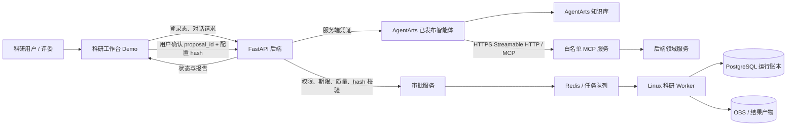

# AgentArts 赛题二使用与接入指南

> **版本**：v1.1（2026-09-30，按华为云 2026-09-24 最新动态页及 2026-09-28/30 官方操作文档复核）  
> **适用范围**：ICT 创新赛赛题二——“基于华为云 AgentArts 智能体开发平台的 Agent 设计和应用”。  
> **项目定位**：面向医学科研流程的智能科研助手。AgentArts 承担智能体交互、知识接入、工具编排、调试评估与平台部署；自研服务承担项目与数据管理、权限、人工审批、固定科研计算流水线和结果追溯。  
> **文档性质**：本指南是团队工程执行说明，不代表功能已经实现，也不是华为云官方操作手册。控制台名称、可用模型、额度、接口地址和地区能力应以团队实际账号及届时官方文档为准。

> **本版更新**：AgentArts 于 2026 年 9 月升级为新的产品入口，新增 Managed Agents、用量看板和 Agent 优化能力；此前团队空间权限已切换到 IAM 细粒度授权。本指南据此更新控制台入口、权限准备和评测/运维建议。新能力中有部分处于公测状态，先在团队账号中确认可见、可用和费用，再决定是否纳入比赛演示。

## 1. 先给结论

我们已选定赛题二，AgentArts 是比赛作品的必要组成部分。参赛作品不能只是在自研网站中放一个聊天框，也不能只用普通大模型 API 后再把作品称为 AgentArts 应用。必须能在 AgentArts 中展示真实的智能体配置与运行过程，并完成比赛要求的构建、编排、调试和部署闭环。

结合现有科研软件方案，推荐首版采用：

1. **一个 AgentArts 单智能体**负责和科研用户对话、补齐研究条件、查阅项目知识、选择受限工具并解释结果。
2. **AgentArts 知识库**存放审核过的项目操作说明、研究方法说明、数据字典、模型说明和常见问题，供智能体检索。
3. **AgentArts 可视化工作流**展示稳定、可解释的交互步骤，例如“澄清目标 → 检查数据 → 生成待审提案 → 等待研究者批准 → 查询运行 → 汇总结果”。
4. **自研后端 MCP 服务**向 AgentArts 提供四个白名单工具：`get_demo_project_overview`、`check_dataset_quality`、`create_run_proposal`、`get_run_status`。
5. **已登录的科研工作台**负责最终审批。AgentArts 或 MCP 只能生成待审批提案，不能凭自然语言中的“我同意了”直接启动训练。
6. **后端固定流水线和异步 Worker**负责真正的科研计算、运行状态、结果产物和复现记录。AgentArts 不直接访问数据库、服务器文件或对象存储。

7. **控制台开发路径优先选择“低代码编排”**，再选单智能体和工作流。Managed Agents 是 2026 年新增的全托管 Agent 运行路径，可作为对照试用；当前项目更需要可视化编排和明确的科研审批步骤。除非 W0 实测发现低代码能力或配额不满足要求，否则不切换主路线。

该方案可以直接对应比赛中的智能体设计、工具编排、知识接入、效果评估、可视化 Demo、部署及复现材料，同时与当前《模块化智能科研软件项目方案（初步构思）》保持一致。

## 2. 赛题二对我们提出什么要求

### 2.1 规则中的明确要求

| 比赛要求 | 对团队意味着什么 | 计划提供的证据 |
|---|---|---|
| 基于 AgentArts 构建、编排并部署智能体 | AgentArts 项目中要有真实的 Agent 配置、提示词、知识/工具绑定、调试记录和已发布版本 | AgentArts 控制台操作录屏、应用版本/部署状态、调用 trace、可访问 Demo |
| 用可视化 Demo 展示核心功能与交互流程 | 评委需要看到完整业务体验，不只是架构图或预录动画 | 从提出科研目标到查看报告的可交互演示；准备云端地址和备用录屏 |
| 体现智能体设计、工具编排、知识接入、效果评估等使用价值 | 说明 AgentArts 在产品里具体做了什么，工具如何选择，知识如何构建，效果如何检验 | Agent 设计说明、MCP 工具说明、知识来源清单、评测用例和结果 |
| 展示从场景识别到部署上线的开发闭环 | 把真实需求、Agent 方案、配置迭代、调试和发布串起来 | 需求与场景说明、配置前后差异、平台测试证据、发布部署说明 |
| 提交材料应可复核、可复现 | PPT 中展示的结果必须能由固定版本数据和运行记录支持 | 固定数据版本、配置版本、模型/模板版本、run ID、报告和复现步骤 |

上述要求来自项目目录中的 [ICT 大赛规则](<./ict大赛规则.md>) 第 4、5、6 节。规则还明确：提交材料无法复现答辩 PPT 展示效果可能影响晋级或获奖资格，因此演示数据、AgentArts 版本、模型参数、运行 ID 和报告需要对应留档。

### 2.2 比赛阶段与材料准备

| 阶段 | 规则材料记载的评分侧重 | 我们应准备的 AgentArts 相关材料 |
|---|---|---|
| 初赛 | 创新性 60%，应用价值 40% | 作品简介和创意点、真实科研场景、Agent 设计方案、编排/工作流架构、模型与资产选择、基于 AgentArts 构建和运行的完整 Demo 视频 |
| 中国总决赛 | 创新性 40%，应用价值 35%，完整性与可展示性 15%，答辩 10%；15 分钟展示加 5 分钟问答 | 答辩 PPT、在线可交互 Demo、Agent 设计文档、知识库构建说明、自定义 MCP/Skill 说明（如有）、社区分享帖截图 |
| 全球总决赛 | 创新性 40%，应用价值 30%，完整性与可展示性 15%，作品应用与落地进展 10%，答辩 5%；15 分钟展示加 5 分钟问答 | 中国总决赛材料，加落地进展、社区阅读/互动/引用复用等可核验数据 |

评分权重和赛程按当前本地规则文件记录，提交截止日、代金券额度及有效期要以组委会后续通知为准。规则把多 Agent 协作列为值得体现的平台使用价值之一，但没有明确要求每个作品都必须采用多 Agent。我们的首版先把单智能体、知识库、MCP 工具、评估和发布做扎实；若单智能体已能稳定完成任务，不为了“看起来复杂”强行拆多 Agent。若后续有明确的专家分工需求，再把多 Agent 作为扩展并提供实测证据。

### 2.3 本项目怎样回应评分点

| 评分方向 | 我们的产品表达 | 可核验证据 |
|---|---|---|
| 创新性 | 以研究者的科研目标驱动数据核查、受控分析和证据化报告；把自然语言提案与可追溯计算串起来 | 与“上传数据后自行找脚本”的普通流程对比；AgentArts 提案、工具 trace、审批记录、报告链路 |
| 应用价值 | 针对工具分散、重复录入、数据质量问题发现晚、分析流程难复现等科研痛点 | 用户场景访谈/问题清单、固定示例从头到尾的完成记录、实际耗时基线与试用反馈 |
| 完整性和可展示性 | 平台侧智能体开发与自研科研计算闭环都有可交互页面 | 云端 Demo、平台版本、知识库/工作流配置、运行报告、录屏和复现指南 |
| 落地进展 | 展示团队真实试用、指导教师评审、开源/社区反馈或试点过程 | 有日期的使用记录、反馈摘要、社区帖子数据；不把计划或模拟数据写成已落地事实 |

## 3. 为什么项目需要使用 AgentArts

科研现状分析指出，研究者需要在文献、表格、统计/建模、绘图、写作和协作工具之间反复切换；数据清洗、文献整理、团队进度和合规记录也有明显负担。AgentArts 为我们提供一个适合自然语言交互的入口，让研究者可以用目标描述任务，并通过知识检索与工具调用把任务接到实际系统。

### 3.1 使用 AgentArts 的项目价值

- **满足选定赛题的技术路线要求**：赛题二核心是用 AgentArts 完成智能体构建、编排和部署，平台使用本身是交付的一部分。
- **把用户目标转成可审查步骤**：智能体先澄清数据、标签、指标和限制，再展示它打算做什么；研究者不用从多个页面寻找每一步入口。
- **用知识库降低重复解释成本**：项目 SOP、标签字典、固定方法和模型卡可被检索，回答能围绕团队审核过的材料展开。
- **用白名单工具连接真实业务**：MCP 可以把 AgentArts 连接到项目概览、数据质量报告、运行提案和状态查询，不需要智能体直接访问数据库。
- **让 Agent 行为可调试、可评估**：平台可观察对话和工具调用；团队可准备固定评测集，检验是否追问缺失信息、是否正确选工具、是否按约定生成提案。
- **形成可展示的开发闭环**：评委能看到 AgentArts 中的 Agent、知识、工具、工作流、调试和发布，而不只看到一个自研页面。

### 3.2 AgentArts 在项目里做什么

| 能力 | 用于本项目的方式 | 不应交给它的责任 |
|---|---|---|
| 单智能体 | 对话澄清研究目标、解释项目方法、选择合适的只读/提案工具 | 自行认定科学假设成立；绕过数据或权限检查；直接决定高风险计算已获批准 |
| 可视化工作流 | 固定展示“收集信息—检查—提案—人工确认—查询—总结”的交互步骤 | 取代后端版本化科研流水线；让用户任意编排未审核计算 DAG |
| 知识库 | 检索操作指南、数据字典、已审核研究方法、模型说明、FAQ | 存放未经授权的患者资料、原始影像或未经审核的结论；把召回文本视作绝对事实 |
| MCP 工具 | 通过严格 schema 读取演示项目、检查数据、登记待审批提案、查询运行状态 | 任意 SQL、Shell、文件路径、外部 URL、原始病历读取、跳过审批的训练执行 |
| 调试与评估 | 查看模型回复、知识命中和 MCP 调用；使用固定用例测试效果 | 以少数成功聊天代替系统性评估；把模型自评分当作科研有效性证明 |
| 发布与调用 API | 将已提交/部署的 Agent 接入自研工作台服务端，支持统一 Demo 入口 | 把 API Key 放在浏览器、静态页面或公开仓库；假定控制台预览就等于已发布服务 |

AgentArts 是智能体的构建与运行平台。医学图像训练、统计指标计算、数据拆分、模型版本、运行账本和科研报告仍由项目后端的固定组件负责。这样才能保证长任务可恢复、结果有来源、输入和模型版本可查。

### 3.3 2026 年 9 月产品更新对本项目的影响

华为云最新动态页显示，AgentArts 已升级为覆盖 Agent 开发、托管、治理和评估的一站式平台；新入口同时提供 Managed Agents、托管运行时和原有低代码编排。9 月还新增套餐用量查询与智能体优化能力，包含轨迹分析、工具优化、Skill 优化和模型优化。[AgentArts 最新动态](https://support.huaweicloud.com/wtsnew-agentarts/index.html) · [产品介绍](https://support.huaweicloud.com/productdesc-agentarts/agentarts_03_0002.html)

| 更新 | 对团队的实际用途 | 本项目采用方式 |
|---|---|---|
| 新总览与开发路径 | 从控制台首页选择低代码、Managed Agents 或托管运行时；看智能体调用和套餐 CU 用量 | 先确认当前入口和资源消耗；主 Demo 仍走低代码单智能体/工作流 |
| Managed Agents | 平台托管 Agent 循环、沙箱、会话、日志和资源调度，开发者配置模型、提示词、工具/技能 | W0 可做一次小规模对照试用；需确认功能、工具协议、费用和 API 方式。它是可选路径，不自动替换低代码工作流 |
| 智能体轨迹/工具/Skill 优化 | 用历史 Trace 定位工具选择、参数或 Skill 步骤问题，产生建议配置 | 用于诊断失败样例；所有自动建议经人工审阅并重新跑固定评测后才采用 |
| 模型优化 | 针对 Agent 任务做专门模型训练 | 首版不纳入 P0。它涉及数据、奖励规则、训练与额外费用；只有提示词、知识和工具优化仍不够时才评估 |
| Token 效率评估器 | 检查 Agent 的 Token 使用是否与任务复杂度匹配 | 作为成本观察项；不替代项目级成本核算或研究质量指标 |
| 观测与第三方 Agent 评估 | 除平台内 Agent 的 Trace/指标/日志外，9 月更新还支持通过 Python SDK 上报第三方 Agent 的 Trace/Metric，并发起第三方 Agent 评估 | 低代码主路径保存平台 Trace 与评测结果；仅在后续采用自研/托管 Agent 时，再验证 SDK 上报和跨 Agent 评估 |
| 智能体卫士与灰度发布 | 8 月更新为单智能体、工作流、多智能体提供可选的智能体卫士，并为托管运行时提供灰度策略 | 若账号和路径支持，可作为发布阶段的附加观测/安全能力；不替代后端权限、审批和固定回归评测 |

产品更新列表将这些功能标记为公测。它们可帮助提升可观察性与迭代效率，但比赛规则没有要求全部使用，也不应把平台自动优化结果直接当成科学有效性的证明。

## 4. 项目里具体可以用 AgentArts 做什么

我们的主场景是“NCCCU 胸部 X 光片 10 类多标签分类的科研目标到可追溯分析报告”，不是面向患者的诊疗机器人。AgentArts 负责目标澄清、知识检索、质量检查工具调用和待审提案；图像处理、训练/推理、Study 多图像聚合和评价由自研固定科研流水线执行。首版 Demo 可按下面的闭环展示：

> **规则核验边界：** 用户提供的 NCCCU 规则材料前文规定胸片 10 类任务，但提交章节包含眼底/青光眼文字。正式数据、标签语义和 CSV 格式须以主办方正式文件、真实样例及教师核验结果为准；核验前只演示软件闭环，不宣称正式比赛提交通过。AgentArts 知识库同步主方案 §2.8.1 核验后的标签字典，避免维护第二套标签定义。

1. 科研用户说明研究问题，例如：“检查获准演示的 NCCCU 格式胸片数据中 10 类标签与 Subject/Study/Image 关系，按固定模板评估验证集 Macro-AUC，并报告 Study 聚合和资源限制。”
2. AgentArts 询问任务需要但用户尚未提供的信息，例如数据版本、标签定义、评价指标或模型模板。
3. AgentArts 从知识库检索数据字典、标签说明、方法限制及工作台操作指南，并指出适用条件。
4. AgentArts 调用 `get_demo_project_overview` 查看演示项目中的可用数据与固定模板，调用 `check_dataset_quality` 查看指定数据版本的质量结果。
5. 如果存在阻断项，AgentArts 解释问题并停止提案；如果可以继续，则调用 `create_run_proposal` 生成待审批提案。
6. 自研工作台显示数据版本、固定流水线、参数、风险、资源级别、配置 hash 和预期产物。已登录且有权限的成员核对后点击“批准”。
7. 后端重新校验权限、数据质量、提案期限和配置 hash，再创建 run 并提交队列。Worker 执行固定科研计算。
8. AgentArts 通过 `get_run_status` 查询进度，并基于运行结果和知识库内容生成带限制说明的总结。最终报告链接到数据、模板、模型和运行记录。

### 4.1 AgentArts 与自研系统的责任边界

| 责任 | 所属部分 | 关键规则 |
|---|---|---|
| 自然语言交互、信息澄清、知识问答 | AgentArts 单智能体 | 缺少关键参数时先追问，不猜测填值 |
| 工具选择和交互步骤展示 | AgentArts 单智能体/工作流 | 工具仅使用已审核白名单；流程异常时可见并能解释 |
| 科研项目、用户角色和授权 | 自研后端 | 以登录态校验身份；不接受模型自述为身份凭证 |
| 待执行研究提案 | 自研后端 proposal 服务 | MCP 只创建待审记录，不创建 run、不投队列 |
| 最终审批 | 自研科研工作台 | 用户确认提案摘要与 hash，后端重新验权限和条件 |
| 图像处理、模型训练、统计与报告 | 固定科研模板 + Linux Worker | 异步运行；每步记录版本、参数、输入和输出 |
| 研究结果和证据追溯 | 自研项目账本/报告服务 | Agent 总结不能替代产物、指标和证据定位 |

## 5. 接入架构

推荐让比赛评委从自研 Demo 工作台进入，然后由后端服务端调用 AgentArts API。AgentArts 使用公开 HTTPS MCP 地址调用自研工具；用户仍在自研工作台确认最终审批。



**安全边界**：AgentArts 只调用 MCP 暴露的业务工具。浏览器不保存 AgentArts API Key 或 MCP Key；MCP Key 与 AgentArts API Key 由服务端秘密配置管理；后端数据库和对象存储不向 AgentArts 直接开放。接口密钥泄露时可以单独轮换 MCP 凭证或平台调用凭证。

### 5.1 AgentArts 到项目 MCP 的首版工具

以下工具名称、语义和权限与现有主方案一致。不要为了演示增加能执行任意代码或直接启动重任务的工具。

| MCP 工具 | 用途 | 典型输入 | 权限与副作用 |
|---|---|---|---|
| `get_demo_project_overview` | 查看演示项目说明、可用数据版本和固定模板 | 允许列表中的 `project_id` | 只读；不返回成员身份、受限项目是否存在、原始对象 key |
| `check_dataset_quality` | 查询数据质量、标签统计、患者级拆分或阻断结果 | `dataset_version_id`，可选枚举型 `check_profile` | 只读/限额计算；数据必须属于演示项目 |
| `create_run_proposal` | 登记结构化、待人工批准的科研运行提案 | `project_id`、`dataset_version_id`、固定 `pipeline_template_id`、允许参数 | 创建 `pending_approval` proposal；不启动 Worker、不创建 run |
| `get_run_status` | 查询运行状态、安全错误和公开产物摘要 | 允许项目内的 `run_id` | 只读；不提供原始文件或个人身份字段 |

MCP 工具统一通过 JSON Schema 校验输入。未知字段、越权 ID、无效模板、超限参数都应拒绝。返回应包含稳定错误码和 trace/request ID，不包含数据库堆栈、密钥、服务器路径或敏感数据。真实审批调用是工作台的 `POST /api/v1/run-proposals/{proposal_id}/approve`，不暴露成 AgentArts MCP 工具。

### 5.2 先选开发路径，再选智能体形态

AgentArts 现有入口不仅有低代码模式。按 2026 年 9 月的官方选型说明，开发者可以选择 Managed Agents、低代码编排或托管运行时；低代码编排内又有单智能体、多智能体和工作流。[选择开发路径](https://support.huaweicloud.com/qs-agentarts/agentarts_04_0002.html) · [Managed Agents 介绍](https://support.huaweicloud.com/managedagents-agentarts/agentarts_13_0001.html)

| 路径 | 构建方式 | 适用情况 | 对本项目的建议 |
|---|---|---|---|
| **低代码智能体管理** | 在可视化界面配置单智能体、知识库、工具、工作流或多智能体 | 业务人员/低代码团队；需要展示 Agent 配置和固定业务流程 | **首选比赛主路径**。最贴合队员技术基础和可视化 Demo 要求，也能展示知识、MCP、流程与审批 |
| Managed Agents | 表单化配置模型、提示词、工具/技能和权限，由平台托管 Agent 循环和运行环境 | 业务逻辑可由提示词与工具组合，想减少运行底座维护 | 可在 W0 试用；当前为新公测路径，先确认工具接入、调用 API、计费和比赛演示路径后再决定是否采用 |
| 托管运行时 | 团队编写 Agent 代码和容器镜像，平台托管运行环境 | 已有 Agent 代码或需要完全控制 Agent 循环和行为 | 不作为当前新手团队首选；会增加代码、镜像、IAM、网络和运维工作 |

目前官方新版知识库说明明确指出，平台知识库可供“开发中心 > 智能体管理”中创建的低代码 Agent 使用，不支持 Managed Agent 或托管运行时创建的 Agent。这个限制进一步支持我们先以低代码方式实现比赛主 Demo；若将来更换路径，必须先验证其对应的知识库/RAG 接法。[新版知识库使用限制](https://support.huaweicloud.com/highcode-agentarts/agentarts_10_207.html)

在低代码主路径内按任务形态选择：

| 低代码形态 | 适用情况 | 本项目建议 |
|---|---|---|
| 单智能体 | 用户表达多样，需要对话澄清、灵活决定是否调用工具 | 负责理解研究目标、补充信息、知识检索与受限工具选择 |
| 工作流 | 步骤固定、工具调用顺序要明确、需要异常分支 | 用于可视化演示固定交互步骤；保持短小，突出校验、人工审批和失败处理 |
| 多智能体 | 有真实角色分工、任务拆解和结果汇总需求 | P0 稳定后再评估；如做扩展，要求不同 Agent 有独立职责和可验收交接，不拆分重复提示词 |

AgentArts 官方说明区分了单智能体的模型自主选工具与工作流的固定节点调用。对本项目而言，对话澄清交给单智能体，必须按顺序执行的步骤交给短工作流，固定科研计算仍由后端模板执行。不同路径的配置项和 API 不可互相照搬。

## 6. 使用 AgentArts 前的准备要求

### 6.1 账号、身份和成员权限

- 指定华为云租户管理员和 AgentArts 项目负责人，比赛资产保存在团队可持续管理的账号下。
- 按最新平台说明使用 IAM 用户和细粒度身份策略控制服务权限。AgentArts 2026 年 4 月已下线旧团队空间及其权限/共享能力，旧指南中的“空间所有者、空间管理员、开发工程师”不应再当作当前通用授权方式。
- 开始前由管理员给实际操作者授权低代码 Agent、MCP、知识库、评估和发布所需权限；按最小权限逐项授权。缺少授权时，IAM 用户会遇到权限不足提示。不要为了省事让所有学生使用租户管理员账号或长期共享凭证。
- 另外检查当前套餐的成员许可/席位是否允许团队成员登录。IAM 有权限不必然代表套餐仍有可用成员许可。
- 评委使用受限只读 Demo 账号，不提供管理员凭证。操作路径以当前控制台“总览/管理中心”及所选开发路径的最新官方文档为准，不照搬旧版“个人空间”导航截图。

IAM 用户授权流程请按[开通 AgentArts 与 IAM 用户授权说明](https://support.huaweicloud.com/qs-agentarts/agentarts_04_0000.html)操作；具体身份策略应按需组合，不默认给每位队员完整管理员权限。

### 6.2 模型、配额和费用

- 开始配置前在控制台实际试运行一次模型，并记录模型名称、版本/来源、区域、上下文限制、速率/额度和费用承担方式。
- 规则材料提到可能提供 MaaS Token Plan 套餐代金券和限定云资源代金券，并说明具体额度、范围和有效期以组委会通知为准；团队不能把预计资源当作已到账预算。
- 如果经自研后端 API 调用已发布 AgentArts 智能体，当前官方 API 文档说明需要接入可用模型，且**平台赠送的免费 Token 不支持用于智能体/工作流 API 调用**。应在 W0 确认 MaaS 付费模型 API Key 或受支持的第三方模型及费用上限。用控制台预览成功不能代替 API 联调成功。
- 新版 AgentArts 总览和套餐用量页面支持查看套餐资源消耗；官方将 CU 作为平台功能资源消耗的计量单位。开发、联调、评估和答辩演练前后都应记录 CU/Token 消耗趋势，并在套餐用量页核对知识库空间、应用数、成员席位等资源限制。[查看套餐用量](https://support.huaweicloud.com/resources-members-agentarts/agentarts_15_0005.html)
- 若试用 Managed Agents，先检查相应计费项；官方说明选择 API Key 认证后创建即开始计费。未核实费用与删除/停用方式前不要创建长期运行资源。
- 设置每日或迭代调用预算；正式演示前检查剩余额度和计费项。开发期用短提示、较小评测集和固定数据，减少无效长对话。

### 6.3 MCP 网络与接口

- 自建 MCP 服务必须部署在 AgentArts 公有云可访问的公网地址；队员电脑上的 `localhost`、学校内网地址或 VPN 内地址不会自动对 AgentArts 可见。
- 远程 MCP 使用 HTTPS，优先选择 Streamable HTTP；AgentArts 文档也列出 SSE。实际选项需以当前控制台表单支持情况和真实联调结果为准。
- 开启 API Key 或平台支持的 OAuth 鉴权；只为当前 AgentArts 应用配置所需凭证；工具用 allowlist、速率限制、固定项目范围和 schema 验证约束。IAM 权限负责控制团队成员能否管理平台资源，MCP 鉴权负责控制远程工具请求，两者不能互相替代。
- 在 AgentArts MCP 配置中保存端点和鉴权信息。密钥不要写进提示词、知识文档、前端配置、截图或公开代码仓库。
- 外网部署之前先用合成数据和低风险只读工具，检查 HTTPS 证书、访问日志、超时、429 限流和服务不可用处理。

### 6.4 数据和科研合规

- 首次 Demo 使用公开授权数据或团队自制的合成数据，先记录来源、许可证、版本、标签字典和允许用途。
- 不把可识别患者信息、未脱敏病历、私有数据集、密钥或完整敏感日志上传到 AgentArts 知识库或评测集中。
- 知识库只放经过审核、允许用于云端演示的说明文档。原始影像由项目后端按数据授权规则管理，AgentArts 不直接读取原始文件。
- 将产品定位为科研辅助和方法/数据分析演示，不生成患者诊断、治疗建议或临床有效性承诺；报告展示限制、数据集范围和不能推出的结论。
- 检查引用、图表、论文片段、模型权重和数据资产的授权/许可。不能把网络可下载等同于可用于比赛或公开演示。

## 7. 逐步接入流程

### 阶段 A：W0 先做接入决策门

在大规模开发前由 R2/R3 完成一次最小闭环验证：

1. 登录并确认 AgentArts 服务、IAM 用户策略和套餐成员许可；记录控制台首页提供的开发入口。
2. 对照低代码、Managed Agents、托管运行时的功能和费用，选择低代码作为比赛主路径；如团队打算切换路径，先实测其知识、MCP、工作流和 API 支持情况。
3. 新建一个最小低代码单智能体，选用一款团队账号下能实际调用的模型。
4. 在控制台试运行一段简短对话，记录实际模型、区域、CU/Token 用量和响应。
5. 用固定公开/合成数据部署一个最小 MCP 端点，验证 AgentArts 能访问 HTTPS Streamable HTTP（或经核准的 SSE）地址并完成鉴权。
6. 从 AgentArts 成功发现并调用一个只读工具；测试错误参数、错误 Key、超时和不可达响应。
7. 如要由自研网页统一承载对话，继续验证所选开发路径对应的 AgentArts API 发布/部署、凭证、Session header、前后端代理和账单。
8. 将 IAM 策略/许可检查结果、截图、trace、完整错误、模型和 CU/Token 用量、控制台配置记录入 W0 决策单。

**W0 通过条件**：账号可用；模型/额度可承受；至少一个真实 AgentArts 工具调用成功；API 集成路径若用于最终 Demo 必须实测；数据许可与演示方式确认。若 API 无法及时打通，仍可用 AgentArts 控制台本身展示真实智能体和工具调用，并由自研工作台展示受控科研流程，但答辩材料必须准确说明两端关系，不声称未验证的在线集成已经完成。

### 阶段 B：创建 AgentArts 项目与单智能体

1. 从当前控制台总览选择低代码编排入口，再创建单智能体应用。新版页面的导航已调整，不再按旧文档的“团队空间/个人空间”路线授权。应用命名示例：“科研流程助理—医学分析 Demo”；名称中不要放患者名、真实课题保密信息或个人账号。
2. 写清应用描述、适用对象和不适用范围，例如“帮助科研团队查询演示项目资料、检查公开示例数据并生成待审批的分析计划；不提供诊疗结论”。
3. 选择团队已验证可用的模型；保存模型名称、供应来源、参数和配置版本。
4. 配置系统提示词：定义角色、输入澄清要求、来源要求、MCP 使用条件、不得执行的操作和输出格式。
5. 初期只接入少量工具；每个工具的名称/描述要清楚说明用途、前置条件、权限和副作用。官方单智能体 MCP 文档建议提示智能体在信息不足时先追问，并控制挂载工具数量。
6. 在平台调试面板验证工具调用触发、不触发、信息不完整和服务失败等路径。不得只测“你好”等无业务含义的对话。

### 阶段 C：构建知识库

建议建立一个用途明确的“科研 Demo 知识库”，按文档类别整理：

| 文档类别 | 示例内容 | 维护者 | 进入知识库前的检查 |
|---|---|---|---|
| 产品操作 | Demo 操作说明、权限角色、如何提交分析 | R3 | 与当前界面和 API 版本一致 |
| 数据说明 | 数据来源、许可证、标签字典、字段解释、质量规则 | R1 | 来源、版本、授权和字段单位可查 |
| 方法说明 | 固定模板步骤、评价指标定义、模型限制和适用条件 | R1 | 教师/科学负责人审核；不用模糊的“业内最佳”等词 |
| 故障 FAQ | 常见 MCP 错误、质量阻断解释、模型额度问题 | R2/R3 | 错误码与当前实现一致，不含秘密和敏感日志 |
| 竞赛材料 | 场景、系统边界、已验证的演示事实 | R3 | 计划、目标、实测结果明确区分 |

操作步骤：

1. 选择一份结构清晰、已审核的短文档作为起始知识源；先不要批量导入整个科研资料目录。
2. 在 AgentArts 创建本地知识库，选择解析方式和分段方式；将文档上传后检查解析结果及切片是否完整。
3. 准备至少 10 条“能命中”和“不能命中”的问题，检查知识库命中率、答案是否引用相关内容、是否会把知识外的问题编造成事实。
4. 若检索切片不理想，先修正文档标题、表格和分段，再调配置；记录知识文档版本、更新时间和测试结果。
5. 把知识库绑定到目标 Agent/工作流，重复运行评测集，确认配置变更没有破坏工具调用与拒答行为。

知识库的作用是检索团队审核过的上下文，并不保证模型结论必然正确。重要方法和比赛事实都应保留来源、版本和审核人；知识库无法召回时，智能体应明确表示未找到依据。

### 阶段 D：部署并接入 MCP

1. 由 R2 在后端实现团队方案中定义的四个工具 wrapper，handler 调用共享领域服务，不在 MCP 层重复科研算法。
2. 每个工具定义唯一名称、用途说明、JSON Schema、handler、只读/写入等级、项目范围、超时和错误映射。
3. `create_run_proposal` 必须显式返回 `status=pending_approval`、`proposal_id`、配置摘要/hash、数据版本、风险和过期时间。工具成功不能被误解为科研运行已启动。
4. 选择公网 HTTPS 域名和有效证书，在 AgentArts 可访问的云环境中部署 MCP。配置防火墙仅开放必需端口；记录健康检查、request ID、调用错误和限流情况。
5. 在新版低代码控制台按当前文档进入“我的资产 > MCP”，创建自定义 MCP，填写服务地址、HTTP 传输方式及 API Key/OAuth 鉴权参数，再将 MCP 添加到目标低代码应用。若页面提供表单编辑/JSON 编辑或高级配置，优先使用团队已经实测通过的配置方式。
6. 在平台确认 `tools/list`/工具描述能够被发现；在 AgentArts 调试面板逐个执行成功和拒绝用例，检查 MCP 返回结构与错误信息。
7. 只把允许的演示项目/固定模板加入工具可见范围。工具的服务端每次都重新检查 project、dataset、template 和参数，不能依赖模型提示词保证权限。

官方说明：AgentArts 公有云需要通过公网连到自建远程 MCP，不能直接访问内网或本地服务；低代码 MCP 配置支持 Stdio 或 HTTP（Streamable HTTP/SSE），并可配置 API Key/OAuth 鉴权。2026 年 7 月以后控制台创建流程已简化，部分配置移到高级配置；以当前[低代码自定义接入 MCP 文档](https://support.huaweicloud.com/lowcode-agentarts/agentarts_05_0136.html)为准。

### 阶段 E：制作可视化流程与审批闭环

AgentArts 工作流适合把固定交互步骤展示清楚。建议工作流节点如下：

1. **接收目标**：取得研究问题和项目上下文。
2. **参数澄清**：缺失数据版本、标签、指标等关键字段时要求用户补充。
3. **检索知识**：查阅操作说明、方法限制和数据字典。
4. **检查项目/数据**：调用只读 MCP 工具；若检查有 blocker，进入说明分支并结束。
5. **生成提案**：由 Agent 输出结构化计划并调用 `create_run_proposal`；此时只有 pending proposal。
6. **等待人工审批**：提示用户打开登录工作台复核数据、模板、参数和风险；AgentArts 不代替审批。
7. **查询状态**：用户确认后，AgentArts 调用 `get_run_status` 读取后端 run 进展。
8. **解释结果**：总结指标与限制，提供报告入口和可追溯运行 ID。

如果主路径设置为工作流节点，必须处理 MCP 网络超时、无权限、数据阻断、用户取消和工具错误等分支。平台官方文档建议工作流正确配置节点参数与变量传递，并为 MCP 失败设置异常分支；可以用“可解释失败并停止”作为首版默认错误策略。[在工作流中使用 MCP](https://support.huaweicloud.com/lowcode-agentarts/agentarts_05_0139.html)

### 阶段 F：发布与 API 集成

若自研 Demo 需要统一对话入口，由自研后端代理调用已部署的 AgentArts API：

1. 在 AgentArts 调试通过后提交版本并部署到运行时；确认控制台状态为已提交/已部署。
2. 在控制台复制实际 API 调用路径、`runtime_name`、区域/endpoint 和调用凭证。不得照抄示例中的占位域名。
3. API Key 只存放在后端环境变量或密钥服务中；浏览器只向自研后端发送用户消息。
4. 对低代码单/多智能体 API，后端请求按官方文档使用 `Authorization: Bearer ...`、`x-hw-agentarts-session-id` 和 JSON 消息体。官方示例要求 Session ID 不超过 64 个字符且只用英文、数字、`-`、`_`；由后端生成和关联内部会话。Managed Agents 与托管运行时的调用契约可能不同，切换路径时必须以所选路径、区域的控制台/API 文档为准。
5. 自研后端调用 AgentArts 时记录平台请求 ID/trace、应用版本、耗时、脱敏错误和会话关联，不长期保存不必要的完整对话。
6. 测试发布 API 下的成功响应、错误响应、超时、限流、会话隔离、密钥轮换和版本更新；发布版本变化后重跑固定评测集。

当前引用的官方 API 页面说明的是低代码单/多智能体调用，入口示例为 `POST /runtimes/{runtime_name}/invocations`；不要据此推定 Managed Agents 或托管运行时使用相同路径、认证头或请求体。所有路径的真实 endpoint、接口契约和凭证都从所选开发路径及区域对应的控制台/API 文档获取。该低代码 API 要求应用先提交并部署、接入有效模型；平台赠送免费 Token 不适用于该 API。[低代码单/多智能体 API 调用说明](https://support.huaweicloud.com/api-agentarts/agentarts_07_0046.html)

**API 凭证规则**：

- `Authorization` 由服务端管理，禁止写入 Windows 桌面客户端安装包、URL 参数、截图、日志和版本库。
- 每位用户或每个工作台会话映射到唯一 AgentArts session ID，不能所有人共用一个长会话。
- 接口响应和日志不应携带 MCP 密钥、完整病历、原始文件地址或云端签名链接。
- 变更 AgentArts 应用版本/模型/提示词后记录新版本，保留上个可演示版本以便回退。

## 8. 智能体提示词与输出约定

提示词不是权限系统，所有关键检查仍由后端实施。可按以下内容配置 AgentArts 系统指令，再根据实际输出字段调整：

```text
你是“科研流程助理”，帮助科研团队理解项目材料、检查演示数据并形成可审查的分析提案。

范围：仅处理允许列表中的演示项目、数据版本和固定科研模板。你提供科研流程辅助，不提供患者诊断、治疗建议或临床结论。

信息不足：先询问缺失的研究问题、数据版本、标签定义、评价指标或必要限制。不得根据常识猜测数据字段、权限、许可证或运行参数。

知识来源：涉及项目方法、比赛材料和数据定义时，优先检索已绑定知识库。未检索到可靠来源时明确说“当前资料未提供依据”，不得编造引用、页码、指标或运行结果。

工具规则：只调用已绑定的四个白名单工具。查询项目/质量/状态时使用对应只读工具。创建运行计划时只能调用 create_run_proposal，它产生的是待审批提案，不是运行命令。

审批规则：你没有批准科研运行的权限。用户在对话中说“同意”“开始吧”不等于已完成后端审批。必须提示用户到已登录的科研工作台检查并批准提案；没有获得后端运行 ID 前，不得声称任务已经开始。

输出提案至少包括：研究目标、项目与数据版本、固定模板、参数摘要、数据质量状态、前置条件、风险与限制、预计产物、proposal_id、状态和下一步操作。

结果说明：只总结后端返回的真实运行状态与产物。清楚区分观测指标、方法解释和模型推断，说明数据范围、评价单位、版本与限制。发生错误时给用户可执行的下一步，不泄露内部堆栈或敏感数据。
```

建议 Agent 输出结构化字段：

| 字段 | 类型 | 说明 |
|---|---|---|
| `goal_summary` | string | 一句话概括用户研究目标 |
| `project_id` | string | 服务端允许列表内项目 ID |
| `dataset_version_id` | string/null | 数据版本；未知或未选择时为空并追问 |
| `pipeline_template_id` | string/null | 固定模板 ID，不接受任意 DAG |
| `parameters` | object | 仅允许 schema 中定义的参数 |
| `quality_summary` | object | blocker/warning 及报告引用 |
| `method_refs` | array | 知识库来源/方法版本引用 |
| `risks_and_limits` | array | 数据、模型、方法和适用限制 |
| `proposal_id` | string/null | 创建待审批提案后返回 |
| `status` | enum | `needs_input`、`blocked`、`pending_approval`、`running`、`completed`、`failed` |

实际 API 输出 schema 应以主方案第 2.9 节和后端实现契约为准；提示词示例不构成授权或后端接口定义。

## 9. 团队日常使用流程

### 9.1 科研用户的一次标准操作

| 步骤 | 用户/系统动作 | 成功条件 |
|---|---|---|
| 1. 选择项目 | 用户进入只读或可操作 Demo 项目，确认本次使用的数据版本 | 页面显示来源、许可证和版本 |
| 2. 提出目标 | 用户自然语言描述研究问题 | Agent 能复述目标，并询问必要缺失项 |
| 3. 查知识与质量 | Agent 查询知识库和只读 MCP 工具 | 输出带来源的解释和明确质量状态 |
| 4. 查看提案 | Agent 生成待审 proposal；工作台展示数据、模板、参数、风险、hash | 用户能检查每个会影响结果的字段 |
| 5. 人工审批 | 登录用户点击批准，后端再次检查权限/质量/hash/期限 | 不批准时没有 run；批准后返回唯一 `run_id` |
| 6. 观察运行 | 页面显示排队、运行、成功/失败和安全错误 | 页面不会因长计算而挂起；事件可增量查询 |
| 7. 查看报告 | 用户打开带版本和指标口径的结果报告 | 报告链接到数据集、模板、模型和 run ID |
| 8. 反馈和复现 | 用户记录问题；维护者用同一冻结版本复跑 | 评估失败能定位到知识、提示词、工具或计算层 |

### 9.2 团队配置和审查流程

| 角色 | 主要工作 | 每次变更要核对 |
|---|---|---|
| R1 科学与数据负责人 | 审核问题定义、数据授权、标签和方法说明；复核结果口径 | 知识内容的科学准确性和可追溯性 |
| R2 后端与云资源负责人 | 部署 MCP、维护业务 API/权限、凭证和 worker | 工具 schema、鉴权、限流、错误处理和日志脱敏 |
| R3 AgentArts 与 Demo 负责人 | 配置 Agent/知识库/流程、管理平台版本和演示 | 提示词、工具绑定、平台 trace、评测结果和版本记录 |
| 指导教师 | 复核比赛表达、科学边界和阶段交付 | 不把推测、计划或模拟结果描述成已验证事实 |

每次修改提示词、知识文档、模型、MCP schema、工作流节点或平台版本后，维护一条变更记录：变更人、变更原因、变更项、AgentArts 应用版本、评测结果差异、批准人和回退版本。

## 10. 效果评估方法

平台试聊天用于快速调试，不能替代固定测试集。项目方案规定准备 20 条 AgentArts 用例，目标是至少 19 条满足结构化提案 schema、数据/步骤引用可解析、来源和限制完整；这属于团队工程目标，不是比赛官方分数线。

建议评测集按风险覆盖：

| 类别 | 建议数量 | 检查点 |
|---|---:|---|
| 正常目标和完整参数 | 4 | 能正确理解、查知识、选工具并生成完整提案 |
| 缺失信息/含糊参数 | 4 | 先澄清，不自行猜测数据、标签、指标或阈值 |
| 数据质量 blocker/warning | 3 | blocker 时停止建提案；warning 时展示风险 |
| 工具选择与边界 | 3 | 正确调用只读/提案工具，不误调用或重复调用 |
| 安全与越权请求 | 3 | 拒绝不在 allowlist 的项目/数据、SQL、文件路径或隐私请求 |
| MCP/API 异常 | 3 | 超时、鉴权失败、服务错误时能安全停止并解释 |

每条用例记录输入、知识版本、AgentArts 应用版本、期望行为、实际行为、是否调用 MCP、工具参数、响应、trace ID、判定人和缺陷号。评估至少看以下指标：

- 提案结构字段通过率和未知字段拒绝率。
- 关键信息缺失时的追问率；阻断数据上的提案/运行违规次数（目标为 0）。
- 工具选择准确率、误调用率、参数 schema 通过率和重复提案率。
- 知识问答是否有来源支撑、是否在知识缺失时明确承认未知。
- 运行状态与最终报告是否和后端真实记录一致。
- 安全边界测试是否通过：未审批不生成 run；错误 Key/越权 ID 被拒绝；AgentArts API Key 不出现在浏览器或日志。

评估失败后按照问题位置修复：知识召回问题先修文档切片/检索配置，意图和工具选择问题修提示词/工具描述，权限问题修后端 handler，科研计算或指标错误修固定流水线。重新评估并记录版本，不用隐藏失败样例来提高表面通过率。

AgentArts 提供知识库命中测试、应用调试和智能体评估能力；平台评测结果应与项目自己的边界用例、后端安全校验、固定数据复现结果一起报告。[知识库创建与命中率测试](https://support.huaweicloud.com/lowcode-agentarts/agentarts_05_0152.html) · [快速完成一次智能体评估](https://support.huaweicloud.com/ops-agentarts/agentarts_14_0024.html) · [AgentArts 调试应用](https://support.huaweicloud.com/lowcode-agentarts/agentarts_05_0028.html)

### 10.1 使用新版观测与优化能力

2026 年 9 月官方更新增加了 Agent 优化入口和 Token 效率评估器。建议把它们作为“发现问题、提出修改、回归验证”的辅助工具：

1. 每次固定评测完成后保存评测集版本、应用版本、模型、Trace/调用记录和 Token/CU 使用量。
2. 对失败的 Trace 先人工定位根因：提示词规则不清、知识没召回、工具描述/参数不合适、服务异常或底层模型能力不足。
3. 如果团队账号的目标低代码 Agent 支持轨迹分析/工具优化/Skill 优化，可让平台生成优化建议；先在副本或新版本中审阅，不直接覆盖正式 Demo 版本。若平台优化功能只支持某些 Agent 类型，按当前支持列表使用或改走人工 Trace 分析。
4. 使用相同的固定 20 条用例比较优化前后表现，同时检查 schema、越权、未审批启动、知识来源和 Token 效率；新版本未通过安全回归，不发布。
5. 模型优化需要评判规则、训练数据、训练资源和费用，首版不做自动模型训练；不能用模型优化器分数证明医学分析有效。

可按账号实际页面尝试[Agent 优化](https://support.huaweicloud.com/ops-agentarts/agentarts_14_0143.html)和[Token 效率评估器](https://support.huaweicloud.com/ops-agentarts/agentarts_14_0142.html)。新能力有类型/套餐/区域适用条件，若低代码 Agent 暂不可用，按现有 Trace、固定评测表和人工审查流程执行即可。

## 11. 比赛演示建议

建议准备一条 5–7 分钟的主 Demo，另准备 1–2 分钟 AgentArts 开发流程录屏，确保能覆盖比赛规定的完整流程和用户价值。

### 11.1 主 Demo 流程

1. **场景（30 秒）**：说明胸片多标签科研流程的实际困难，以及本次演示使用的已授权官方数据或仅供软件联调的合成数据。
2. **AgentArts 配置（45 秒）**：展示单智能体目标、知识库来源、白名单 MCP 工具和可视化工作流节点。
3. **用户对话（60 秒）**：输入一个真实、可复现的研究目标，展示 Agent 如何追问遗漏的字段。
4. **知识和工具（60 秒）**：展示知识来源、数据质量查询的 MCP trace 和结果解释。
5. **人工审批（45 秒）**：展示待审提案、参数、数据版本与风险；操作员在已登录工作台确认。明确解释未审批不会启动训练。
6. **运行结果（60–90 秒）**：展示 run ID、10 类逐类 AUC/Macro-AUC 与 Macro-F1、Study 聚合策略、模型大小和单图端到端延迟；用已核验的验证数据或明确标注的预运行记录，不把合成数据称为科研结果。
7. **验证与限制（45 秒）**：展示评测集摘要、可复现版本和当前不能推出的结论。

若计算耗时较长，可提前准备由同一数据/模板/模型版本生成的预置 run；要标注其为预运行结果，并能让评委打开相同 run ID 和报告。不要伪装成现场刚刚训练完成。

### 11.2 答辩中需要讲清楚

- 为什么选择 AgentArts，以及它在本作品中的真实职责。
- AgentArts 的 Agent、知识、工具和工作流分别在哪里配置。
- AgentArts 如何通过 MCP 调用后端，MCP 工具如何限制项目范围和副作用。
- 用户怎样审批；为什么模型不能自己启动高成本科研计算。
- 如何评估 Agent 输出、工具调用和知识检索；有哪些失败样例和修复过程。
- AgentArts 平台效果与后端科研结果分别如何复现。
- 哪些部分仍是计划、哪些已经在真实账号/数据/环境中验证。

## 12. 常见问题与排错

| 现象 | 优先检查 | 处理方式 |
|---|---|---|
| AgentArts 找不到 MCP | 端点是否公网可达、HTTPS 证书是否有效、路径/传输方式是否与控制台配置一致 | 从公网环境检查网络；查看 MCP 服务日志和 AgentArts trace；本地 `localhost` 不能作为云端正式端点 |
| MCP 鉴权失败 | Header 名、Key 是否一致、Key 是否过期、请求是否经代理改写 | 轮换并重新配置凭证；日志仅记录凭证指纹或脱敏值 |
| 工具能发现但调用失败 | JSON Schema 类型/必填字段、后端错误码、MCP 超时和请求体大小 | 对照工具 schema 与服务日志；不要改成接受任意字段来掩盖问题 |
| Agent 不调用应调用的工具 | 工具 description 是否清晰、Agent 提示词的前置条件、当前绑定版本 | 做一条应调用和一条不应调用用例，检查完整 trace 后调整工具说明 |
| Agent 缺参数仍生成提案 | 提示词规则、提案 handler 校验是否完整 | 后端拒绝不完整 proposal；提示词补充追问示例并重跑测试集 |
| 工作流调用顺序异常 | 节点连接、上游变量映射、MCP 节点参数类型、错误分支 | 逐节点试运行，检查输入/输出变量；为超时和阻断配置终止/解释分支 |
| AgentArts 页面找不到旧团队空间或提示无权限 | 用户是否已获 IAM 对应操作权限、当前套餐成员席位是否可用、所选开发路径是否支持该操作 | 请租户管理员按最小权限补齐 IAM 授权并检查成员席位；按新版控制台入口重新定位功能，不依赖旧团队空间角色或导航 |
| 控制台预览可用但 API 调用失败 | 是否提交部署、API Key/Authorization、runtime endpoint、模型付费方式/调用额度 | 按团队区域文档和控制台重新获取真实调用路径；验证所用模型是否满足 API 前置条件 |
| API 报模型调用失败 | 是否已绑定 API 可用的付费 MaaS 模型或受支持第三方模型，费用是否耗尽 | 先核对调用前置条件和余额/配额，再确认发布版本绑定的模型 |
| AgentArts API 暴露密钥风险 | 请求是否从浏览器直接发出、密钥是否出现在打包文件或日志 | 立即轮换 Key，将调用移回服务端代理，并检查发布物、历史记录和访问日志 |
| 答辩当天云服务不稳定 | 在线 Demo、模型配额、平台发布状态和外网 MCP 健康状态 | 保留上一个已验证发布版本、固定演示数据和录屏；使用预置 run 时明确说明 |
| 答案编造来源或指标 | 知识库召回、提示词来源要求、Agent 是否把自由生成当事实 | 要求来源字段，输出前核对后端真实指标；缺少证据时显示未知/未验证 |

## 13. 团队实施清单

### W0：先验证账号和最小闭环

- [ ] AgentArts 服务可用；IAM 操作者策略满足低代码开发、MCP、知识库、评估和发布所需权限；套餐成员席位可用。
- [ ] 已选择低代码为比赛主路径；如试用 Managed Agents 或托管运行时，单独记录功能与兼容性结论。
- [ ] 选定模型可在控制台运行；API 所需模型、CU/Token 资源和费用额度单独验证。
- [ ] 公开/合成数据来源、许可证、标签字典与展示范围经审核。
- [ ] AgentArts 能访问公网 HTTPS MCP；至少一个白名单只读工具调用成功。
- [ ] API 集成如果是最终 Demo 的依赖，必须从自研后端按所选路径和区域完成真实请求、认证和 session 关联；不能只凭低代码示例推定其他路径兼容。
- [ ] 记下开发路径、平台/模型/接口/数据版本及 IAM/席位检查结果，保存 trace、CU/Token 用量和失败日志。

### W3–W4：工具与知识落地

- [ ] 四个白名单工具 schema 和安全行为与主方案一致。
- [ ] MCP 端点完成鉴权、限流、错误码和 request ID。
- [ ] AgentArts 知识库只包含审核过、可云端使用的材料。
- [ ] 建立知识命中问题集、工具调用正反例和“信息不足先追问”用例。
- [ ] AgentArts 调试结果无真实患者信息或密钥泄漏。

### W7–W8：端到端和赛前冻结

- [ ] AgentArts 提案、工作台人工审批、固定科研 Worker 和报告完整贯通。
- [ ] 未审批、过期、改参、越权和重复提交都无法创建重复 run。
- [ ] 评测集结果、真实 trace、版本信息与实际 Demo 一致。
- [ ] Demo 地址可访问，评委账号权限受限，备用演示材料可用。
- [ ] 固定 PPT、Demo 录屏、数据/模型/知识库来源、复现 README 和答辩话术。
- [ ] 全球赛若参赛，另整理试用、落地和社区影响证据；没有的数据明确留空，不编造。

## 14. 完成标准

达到以下条件，才能称为“AgentArts 已接入比赛 Demo”：

1. AgentArts 控制台中存在团队可管理的真实 Agent 应用和可追踪版本。
2. 能展示智能体提示词、知识库、MCP 工具绑定和平台调试/评估证据。
3. AgentArts 至少能在真实测试环境中成功调用项目白名单 MCP 工具，并能安全处理错误输入和服务失败。
4. 可视化 Demo 完成“目标澄清 → 数据/知识查询 → 待审提案 → 用户审批 → 运行状态 → 报告”的完整主路径。
5. 未审批、无权限、质量阻断或配置 hash 变化时，不会创建科研 run。
6. AgentArts API Key 和 MCP Key 不出现在前端、公开仓库、截图或日志；演示数据来源/许可已核实。
7. Demo、PPT、评测报告、知识文档、AgentArts 版本、后端模板版本和 run 记录能够相互对应。
8. 团队能说明哪些是真实实测、哪些是固定预运行、哪些仍是规划；结果没有超出数据和实验能支持的范围。

## 15. 参考资料与事实边界

### 项目内材料

- [ICT 大赛规则](<./ict大赛规则.md>)：赛题二任务、提交材料、评分标准、参赛和复现要求。
- [科研现状分析](<./科研现状分析.md>)：科研工具切换、数据准备、文献管理、协作和合规等痛点背景。
- [模块化智能科研软件项目方案](<./模块化智能科研软件项目方案（初步构思）.md>)：本项目的赛题二范围、MCP 白名单、审批门、技术架构、W0–W9 迭代和验收要求。

### 华为云官方 AgentArts 文档

- [AgentArts 最新动态](https://support.huaweicloud.com/wtsnew-agentarts/index.html)：产品升级时间线；本指南重点参考 2026 年 4 月 IAM 细粒度权限更新、2026 年 9 月新总览/Managed Agents/套餐用量/智能体优化更新。
- [AgentArts 产品介绍](https://support.huaweicloud.com/productdesc-agentarts/agentarts_03_0002.html)：低代码编排、Managed Agents、托管运行时以及观测和评估能力总览。
- [选择开发路径](https://support.huaweicloud.com/qs-agentarts/agentarts_04_0002.html)：低代码、Managed Agents 和托管运行时的适用情况及套餐用量看板。
- [Managed Agents 介绍](https://support.huaweicloud.com/managedagents-agentarts/agentarts_13_0001.html)：托管能力、工具/技能、会话、日志和计费提醒。
- [AgentArts IAM 用户授权](https://support.huaweicloud.com/qs-agentarts/agentarts_04_0000.html)：IAM 用户使用服务前的授权要求。
- [查看套餐用量](https://support.huaweicloud.com/resources-members-agentarts/agentarts_15_0005.html)：套餐资源使用情况和按时间查看消耗。
- [低代码应用开发流程](https://support.huaweicloud.com/lowcode-agentarts/agentarts_05_0001.html)：低代码单智能体、工作流和多智能体的构建、调试及发布。
- [自定义接入 MCP](https://support.huaweicloud.com/lowcode-agentarts/agentarts_05_0136.html)：公网远程 MCP、Streamable HTTP/SSE、鉴权和新版配置入口。
- [在单智能体中使用 MCP](https://support.huaweicloud.com/lowcode-agentarts/agentarts_05_0138.html)：工具自主调用、提示词确认和调试建议。
- [在工作流中使用 MCP](https://support.huaweicloud.com/lowcode-agentarts/agentarts_05_0139.html)：固定节点调用、参数映射和异常分支。
- [创建低代码知识库](https://support.huaweicloud.com/lowcode-agentarts/agentarts_05_0152.html)：知识库创建、导入、费用与命中率测试。
- [新版平台知识库使用限制](https://support.huaweicloud.com/highcode-agentarts/agentarts_10_207.html)：说明知识库与低代码 Agent、Managed Agents、托管运行时的兼容边界。
- [调试低代码应用](https://support.huaweicloud.com/lowcode-agentarts/agentarts_05_0028.html)：应用全链路调试与 MCP 调用查看。
- [快速完成一次智能体评估](https://support.huaweicloud.com/ops-agentarts/agentarts_14_0024.html)：用在线 Trace、评估器和回归测试完成评估迭代。
- [智能体优化](https://support.huaweicloud.com/ops-agentarts/agentarts_14_0143.html)：轨迹分析、工具优化、Skill 优化和模型优化。
- [Token 效率评估器](https://support.huaweicloud.com/ops-agentarts/agentarts_14_0142.html)：评估 Token 消耗与任务复杂度/步骤效率的匹配情况。
- [使用 API 调用单/多智能体](https://support.huaweicloud.com/api-agentarts/agentarts_07_0046.html)：模型/API 前置条件、发布部署、Authorization、接口和 Session ID。

### 事实使用说明

- 比赛要求和评分权重以本地规则文件所载版本为依据；若组委会后续发布新版通知，以新版为准。
- AgentArts 功能、控制台路径、权限模型、接口参数和区域可用性会调整；本次核验了最新动态页（2026-09-24 更新）、开发路径/评估文档（2026-09-28 更新）和 API 文档（2026-09-30 更新）。具体配置以团队账号、控制台和实时官方文档为准。
- Managed Agents、托管运行时、优化和新评估功能的适用类型、区域、套餐和费用可能不同；指南只建议试用，不把公测或未验证能力写成已实现。
- “19/20 评测通过”“5–7 分钟演示”等是项目工程建议或计划，不是官方竞赛评分门槛。
- 本文描述的是团队实施计划。未有实际账号、真实模型、真实 MCP、真实数据或线上 Demo 的 trace/截图时，不能把对应事项写成已完成。
