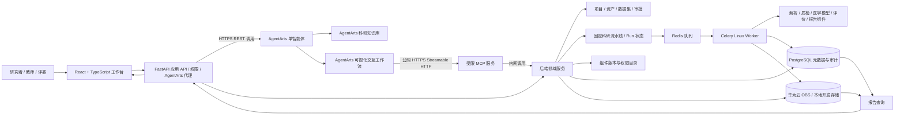

# 模块化智能科研软件项目方案

团队讨论稿 · 比赛阶段聚焦医学科研 · 2026 年 9 月

这份方案供团队讨论产品定位、开发边界和演示路线。赛题二版本以华为云 AgentArts 作为智能体与可视化流程平台，自研科研服务提供受控组件、固定计算流水线、项目数据与运行追溯；AgentArts 根据科研目标生成提案并调用白名单工具。比赛 P0 冻结为一个医学数据集、一项研究问题、一条固定模板、一项可核查论文主张对照和一条 AgentArts 真实工具调用闭环；完整论文复现与多论文审查列为 P1，少量生物组件列为 P2。

## 一 项目定位与范围

科研计算能力拆成输入输出明确的后端组件，由版本化固定流水线执行；AgentArts 负责目标澄清、知识检索和受控工具编排。用户面对的是“完成一项研究任务”的过程，底层组件保持可复用。

| **组成**     | **比赛阶段目标**                                                   | **展示作用**           |
|--------------|--------------------------------------------------------------------|------------------------|
| 通用科研底座 | 组件接口、固定流水线运行、项目状态、事件记录、AgentArts 工具接入 | 证明能力能够组合与追踪 |
| 通用科研组件 | 文献、文件与数据读取、质量检查、统计、可视化、报告、论文复现与审查 | 覆盖多数科研共性任务   |
| 医学组件     | 医学影像数据、预处理、模型训练、评价、解释与泄漏检查               | 完成主场景的完整闭环   |
| 生物扩展示范 | 菌株或培养记录、OD 与 pH 数据接入及分析                            | 展示相同通用组件的复用 |

当前阶段只承诺数字化研究流程和人工录入的实验数据闭环。真实仪器控制、无人实验室和多个学科的完整方案列为后续扩展。

## 二 科研组件的划分

我们按科研能力拆组件，再按学科提供专业插件包。同一个统计组件可以服务医学评价和发酵实验，医学图像处理与菌株培养记录则分别属于专业组件。每个组件至少约定输入、输出、参数、运行状态、错误处理和产物来源，才能可靠地由固定流水线和 AgentArts 白名单工具调用。

| **类别**  | **建议纳入的组件**                                                                      | **用途**             |
|-----------|-----------------------------------------------------------------------------------------|----------------------|
| 通用      | 文献检索与阅读；PDF/CSV 解析；数据质量检查；统计与绘图；实验记录；报告生成；Python 执行 | 跨学科复用           |
| 特色通用  | 论文方法提取；代码或统计复算；证据审查；结果对比；复现报告                              | 独立调用或插入工作流 |
| 医学      | 医学图像导入与预处理；模型训练；ROC/AUC、敏感度和特异度；交叉验证；泄漏检查；Grad-CAM   | 医学 AI 主流程       |
| 生物 Demo | 菌株信息；培养条件记录；OD/pH 数据读取与趋势分析                                        | 扩展能力展示         |

## 三 论文复现与审查的定位

论文复现与审查是组件库中的特色能力，与数据分析、模型训练、实验设计等组件处在同一层级。比赛 P0 只对一篇论文的一项主张建立可核查证据记录，并在口径一致时与本项目结果对照；完整方法抽取、代码或统计复算和多论文审查列为 P1。该组件未来可单独生成复现报告，也可在研究开始时审查参考文献，或在研究结束后对比本项目结果与论文结果。
- 输入：论文及其可用的代码、数据、补充材料，也可接入本项目的实验结果。
- 处理：提取可核查的方法与结果；列出缺失条件；在有代码或数据时运行数字复现和统计复算；记录偏差与限制。
- 输出：逐项证据、可复现范围、数值或趋势对比、未核实事项与审查报告。

如果缺少原始数据、代码或关键条件，组件应标记“无法核查”及原因，不应将文献阅读等同于实证复现。湿实验只能生成复现实验计划和人工录入结果，不能声称自动完成物理实验。

## 四 产品四层结构

| **层级**   | **职责**                                             | **面向用户的表现**                  |
|------------|------------------------------------------------------|-------------------------------------|
| 科研组件   | 完成边界清晰的单一任务                               | 直接选择并运行一个功能              |
| AgentArts 展示流程 | 连接对话步骤、知识和白名单工具，管理提案状态 | 用自然语言发起任务并确认待审批提案 |
| 固定科研流水线 | 按已发布模板执行科研组件、管理计算状态和产物 | 选择固定模板/受限参数，查看节点运行 |
| 科研应用   | 封装可复用的完整研究任务                             | 医学 AI 主应用、复现应用、生物 Demo |

项目状态负责记录研究目标、数据集、论文、运行、结果和结论之间的关系；事件记录负责保存 AgentArts 提案、人工审批和每次组件运行的输入、参数、版本、操作者和输出。AgentArts 管理交互流程，后端项目账本记录科研事实。

## 五 长期产品的三种使用方式（赛题 P0 不全部实现）
1. 直接使用组件：上传数据后点击 ROC 分析、质量检查或论文审查，适合一次性任务。
2. 工作流模式：选择医学 AI 模板后增删节点、调整连接和参数，适合熟悉流程的科研人员。
3. Agent 模式：输入研究目标，Agent 先展示拟执行步骤及所需数据；用户审阅后执行。运行中展示进度、结果和下一步建议。

三种入口最终调用同一套组件和运行接口，避免出现 Agent 能演示、工作流却无法重放的问题。**这是长期产品目标，不代表赛题 P0 全部交付**：比赛首版只做 AgentArts 交互与受控工具、固定医学模板；直接运行任意组件和用户自由增删/连线的工作流列为后续版本。

## 六 医学科研主 Demo

医学 AI 是比赛的重点落地场景。建议以一个明确任务贯穿演示，例如胸部 X 光多标签分类或眼底图像青光眼筛查；具体选题可根据可用数据和比赛要求确定。

**比赛 P0 主流程：**

研究问题 → 选择一项论文主张并登记证据 → 数据导入 → 质量与泄漏检查 → 预处理 → 模型推理/评价 → 同口径论文结果对照 → 报告

答辩现场的可见产物应包括：一项带来源定位和人工审核的论文证据卡、数据质量报告、固定科研模板运行记录、模型评价图表、论文对比结论和最终研究报告。若训练较长，可展示代码/模型/数据/模板/参数完全对应的预运行记录并醒目标注，同时现场执行耗时短的真实质量检查或模型推理。

医学组件建议先覆盖最小可行闭环：图像与标签导入、样本或患者分组检查、训练或加载已有模型、ROC/AUC 与敏感度和特异度计算、错误病例分析。DICOM、CT/MRI、多模型集成等属于按数据需求追加的能力。

## 七 生物组件扩展示范

生物方向只负责证明组件可以跨领域复用。选择菌株培养或发酵数据的小型数据集，增加菌株、培养条件、OD/pH 记录等专业组件，沿用文献读取、CSV 导入、统计绘图、论文比较和报告生成等通用组件。

**扩展流程：**

文献读取 → 菌株与培养记录 → OD/pH 导入 → 统计绘图 → 论文结果比较 → 实验报告

演示时清楚指出哪些节点和医学流程共用、哪些节点被专业组件替换，并保留两次运行记录。生物 Demo 不承担完整自动化湿实验的承诺。

## 八 Agent 自动科研如何落地

赛题二版本中，Agent 运行在华为云 AgentArts。AgentArts 负责把研究目标转成可检查的提案、提出缺失信息、调用有限科研工具并解释运行结果；自研后端负责权限、审批、真实计算和运行账本。首版不自行开发通用 Agent 规划器或多智能体平台。
- AgentArts 单智能体理解目标和可用资源，识别缺失的数据、指标或权限；必要时先追问。
- AgentArts 工具目录只开放经过 schema 和权限校验的科研工具；可视化工作流展示确定的用户交互步骤。
- 执行前在科研工作台呈现计划摘要、数据、参数、风险和预期产物；已登录研究者必须主动批准。
- 经批准后由后端固定科研流水线执行组件，更新状态并保存日志与产物；P0 失败后保留错误和产物引用，用户修复输入后新建 run，不提供复杂重试/取消编排。
- AgentArts 根据来源明确的运行结果总结限制并提出下一步；它不能自行修改历史实验或伪造成功状态。

“智能体应用”必须由 AgentArts 中真实的智能体、工具调用、平台调试/评估和部署来证明；自研科研后端提供其受控业务能力和可信运行证据。

## 九 比赛开发优先级

| **级别**    | **交付范围**                                                                        | **完成判据**                                             |
|-------------|-------------------------------------------------------------------------------------|----------------------------------------------------------|
| P0 必须完成 | AgentArts 单智能体、知识库/工作流、真实工具调用和评估；固定医学模板；人工批准；正式质量门与模型推理；可追溯报告；一项论文主张证据与本项目结果对照 | W3–W4 先打通 AgentArts → 工具 → 提案 → 工作台批准 → 短任务 → 结果；之后替换为正式医学质量/模型能力；平台构建、编排、部署证据可现场展示 |
| P1 特色能力 | 论文自动抽取、完整方法审查、代码/统计复算、多论文比较；额外 AgentArts 提案优化和模板 | 所有论文结论有定位与限制；无数据/代码/关键条件时不得声称实证复现 |
| P2 扩展展示 | 少量生物组件与小型演示工作流                                                        | 沿用同一底座和通用组件，输出独立运行记录                 |

暂不以复杂实验室硬件控制、完整化学或材料科研包、全部疾病和全部医学模态为比赛目标。工作量应根据人员、数据权限和比赛截止时间再拆成迭代任务。

## 十 团队讨论与分工依据

第一次方案会建议先统一三件事：医学主任务选题和可用数据；AgentArts P0 闭环的演示输入与输出；科研工具接口和运行日志的最小规范。之后再分配工作台、后端运行底座、AgentArts 配置、医学组件与论文审查模块的负责人。
- 每新增一项功能，明确它的输入输出、是否能嵌入现有工作流、Agent 是否能够调用。
- 每个 Demo 固定一套示例数据与预期产物，进行从头运行和失败恢复演练。
- 答辩表述区分已经实现、正在开发和未来扩展，避免把规划功能讲成现成功能。

## 十一 一句话介绍

我们计划开发一个模块化智能科研应用：由华为云 AgentArts 提供智能体、知识接入和可视化流程，自研科研后端提供有权限控制、可追溯的医学分析组件与固定计算流水线；比赛期间优先完成医学 AI 研究闭环，生物扩展只在 P0 验收后考虑。

## 二 工程实施计划（2.1–2.9）

> **文档用途**：本章把第一章的产品构想转成可分工、可验收、可复现的比赛项目计划，不代表相关功能已经实现。本文中的“建议值”是团队启动时的工程目标，应通过 Sprint 0 的设备、数据和云资源验证后冻结。
>
> **赛题锁定**：团队已决定按赛题二“基于华为云 AgentArts 智能体开发平台的 Agent 设计和应用”实施。AgentArts 智能体设计、工具编排、知识接入、调试评估、部署和可视化 Demo 是贯穿需求、架构、迭代与交付的必选主线。Sprint 0 的平台试接用于验证 AgentArts 账号、工具接入和云端运行条件。
>
> **事实边界**：比赛材料给出的赛程为报名 2026-08-31 至 2026-11-30、初赛 2026-12、中国总决赛 2027-03、全球总决赛 2027-05；各阶段准确提交日以组委会通知为准。医学任务、数据集、云服务额度、AgentArts 可用接入方式均需在对应决策门核实。

### 2.1 需求分析

#### 2.1.1 问题、目标与产品边界

| 研究痛点/比赛诉求 | 当前问题 | 本项目的可验收回应 |
|---|---|---|
| 工具切换和信息碎片化 | 文献、数据、分析、模型结果与汇报材料散落在不同工具，研究者需反复搬运文件和结论 | 以“研究项目”为工作空间；文件、数据集、工作流运行、模型、证据和报告均关联同一 `project_id`，并能从报告追溯到运行与输入 |
| 数据清洗与预处理 | 格式、标签、缺失值、重复样本和数据泄漏问题常靠人工发现 | 提供可配置的数据检查组件；医学数据运行训练前必须生成质量报告并通过阻断级规则 |
| 文献证据难追溯 | 方法和结论从论文摘录后，容易丢失页码、来源和适用限制 | 文献解析输出带文档标识、页码/段落位置的证据片段；Agent 生成事实性总结时附证据引用，无证据时显式标成“未核实” |
| 工作流不易重放 | 手动步骤、依赖版本和参数未统一记录，难以复核答辩结果 | AgentArts 负责展示型流程；后端固定流水线每次运行保存模板/组件版本、输入摘要、参数、操作者、状态、日志和产物；固定示例可由 run ID 重放 |
| 比赛创新赛要求 | 必须体现对应华为技术、可视化 Demo、真实场景价值和可复现展示 | 赛题确认后建立专门适配层；演示脚本、云端地址、固定数据、预置结果、部署说明与答辩材料逐项对应 |

**产品目标**：让医学科研用户通过 AgentArts 提出研究目标，完成信息澄清、数据质量检查、人工审批、医学图像模型训练/评价/解释、报告生成；AgentArts 展示型工作流连接用户交互与受限工具，后端固定科研流水线保证计算可检查、可追溯、可重放。生物流程只证明通用底座能复用，不承诺自动湿实验。

**目标衡量方式（计划目标，须经 Sprint 0 试测校准）**：

1. 固定医学演示数据集能从导入、质量检查、预处理、评价到报告端到端完成；至少连续 5 次重放成功，输入版本、参数和产物关系完整率为 100%。
2. 对 20 条预先编写的 AgentArts 任务用例，至少 19 条满足结构化提案 schema、数据/步骤引用可解析、来源和限制字段完整；未审批不得创建科研 run；缺失关键信息时能追问或拒绝。
3. 每一项报告结论至少能定位到数据统计、模型运行产物或论文证据之一；无法定位的内容不得作为确定性结论展示。
4. 以 5 个代表性研究操作记录人工基线和平台耗时，目标是高频重复步骤的中位用时降低至少 30%；这是待验证假设，不作为未经测量的产品效果宣传。
5. 演示环境至少支持 5 个并发只读/操作用户；元数据查询接口建议 p95 ≤ 500 ms，报告首次打开建议 ≤ 3 s，耗时分析任务通过异步状态反馈而非阻塞网页请求。

#### 2.1.2 用户、场景与权限

| 用户/角色 | 主要目标 | 权限建议 | 核心场景 |
|---|---|---|---|
| 医学科研学生/研究助理 | 准备研究数据、运行分析、生成可审阅结果 | 项目成员：创建数据版本、选择固定模板、提交待审批提案 | 选择公开医学影像及标签，查看质量问题，在工作台请求训练和评价 |
| 医学/生物方向指导教师或 PI | 审核研究方案、数据适用性、指标与结论边界 | 项目所有者/审核者：批准运行提案、查看全量产物、冻结演示版本 | 检查患者级拆分、阈值选择和论文证据，再批准受限模板执行 |
| 团队开发者/数据负责人 | 维护组件、示例数据、AgentArts 配置、部署和故障恢复 | 维护者：发布科研组件/固定模板，管理 AgentArts 版本与权限，查看运行日志 | 新增医学组件并验证输入输出契约；修改 AgentArts 流程需登记和复测 |
| 评委/复核者 | 快速理解方案，重放关键结果并核对答辩材料 | 演示访客：只读示例项目；如需交互，使用可重置的演示账号 | 打开演示项目、运行短路径或读取预置长任务结果、下载复现包 |

所有项目对象默认私有；匿名演示只暴露预置、脱敏、可公开的数据和报告。教师审核是科研流程治理功能，不代表临床诊断或伦理审批。

#### 2.1.3 范围、优先级和明确不做项

| 优先级 | 范围 | 交付判据 |
|---|---|---|
| P0 / 比赛闭环 | 一个医学项目/问题/固定模板；Demo 必需的两种权限；模板内组件契约；AgentArts 单智能体、知识/可视化流程、真实工具调用、评估与发布；W3–W4 薄纵向链路；正式医学质量门、模型推理、审批、运行和报告；一项论文主张证据及同口径结果对照 | 评委能现场看到 AgentArts 真实调用，经工作台批准后执行短任务；正式 Demo 可现场质量检查或推理，并回看同版本训练记录；论文对照含来源、位置、口径和人工审核 |
| P1 / 特色能力 | 论文自动方法抽取、代码/统计复算、多论文审查和完整复现报告；受控组件目录及预置组件包启停/版本切换；更多模板及高级运行治理 | 每项审查有证据定位、可复现范围、缺失材料和限制；新增平台能力不要求自研通用工作流画布 |
| P2 / 扩展展示 | 菌株/培养条件及人工录入 OD、pH 的生物演示；共享医学底座组件 | 单独运行并产生记录，清楚标注复用节点与生物专用节点 |
| 本阶段不做 | 仪器控制、自动化湿实验、临床诊断/治疗建议、真实患者数据上传、医院业务系统接入、全学科完整工具箱、复杂实时协同编辑、面向公众的任意文献爬取 | 需求进入后续版本评估，不进入比赛 P0 范围 |

#### 2.1.4 质量属性与建议验收目标

| 质量属性 | 设计要求 | 验收方法/目标 |
|---|---|---|
| 可复现性 | 版本、输入校验和、参数、随机种子、运行环境标识、日志与产物均留痕 | 固定数据工作流重复执行 5 次；每次均可查看输入、组件、参数和结果关系；数值比较采用预先说明的容差 |
| 科学严谨性 | 病例级拆分、防泄漏、测试集隔离、阈值来源披露、指标注明适用范围 | 运行前质量门控阻止患者跨集合；报告注明队列、标签定义、拆分策略、指标和限制 |
| 安全与隐私 | 首版只使用已授权的公开/合成数据；最小权限、传输加密、受限访问、可删除 | 演示路径不接收未脱敏患者身份信息；私有项目不能通过访客权限访问 |
| 可观察性 | AgentArts 对话/工具 trace、待审提案、固定流水线和 run 显示状态、耗时、错误和修复提示 | AgentArts trace 可关联本地 request/trace ID；失败运行可定位到节点和错误码；不泄漏密钥、审批信息或原始敏感内容 |
| 可用性 | 中文主界面；步骤状态可见；长任务不阻塞页面 | 新用户按一页操作指引在 10 分钟内完成一次示例项目浏览和短运行 |
| 性能与成本 | 大文件走对象存储/分片上传；训练和文献处理走异步任务；资源限额明确 | Sprint 0 测量可用额度和数据规模后冻结单文件、单项目、并发和运行时限；超过上限时提前报错并给出替代路径 |
| 可移交性 | 固定演示数据、环境变量说明、部署和复现操作步骤版本化 | 新环境按 README 从空环境部署并复现展示结果；缺少云资源时有本地/录屏兜底方案但不冒充在线云端部署 |

#### 2.1.5 约束、假设和团队决策

- 团队按规则由 3 名学生与 1 名指导教师组成；以下职责按岗位而非姓名分配，报名后成员不能随意替换这一赛制风险应在团队治理中显式管理。
- 比赛主场景为“医学 AI 闭环”；具体任务在“数据公开可用、标签定义清楚、许可证和下载条件明确、单机/云资源能完成演示、评价有科研意义”五项全部通过后冻结。若医学影像数据不可用，应优先换到方案中已列的另一种医学影像任务，不以无授权数据顶替。
- AgentArts 可接入的工具协议、鉴权、配额、知识接入及部署方式以团队实际账号和当前官方指南试接结果为准。本方案只定义内部适配接口，不臆造厂商 API 字段。
- 预算、云代金券、模型调用额度和 GPU 可用性未知。系统设计须支持用预置已完成运行展示长任务，并现场真实运行耗时短、输入固定的工作流节点。
- 医学输出是科研原型，不供临床诊断；Grad-CAM 等可视化只作模型行为检查，不证明因果解释或临床有效性。

### 2.2 用户故事

优先级：P0 为初赛前必须进入可运行闭环，P1 为特色或总决赛增强，P2 为扩展演示。验收条件应可从 Demo 或运行产物直接确认。

| 编号 | 优先级 | 用户故事 | 验收条件 |
|---|---|---|---|
| US-01 | P0 | 作为医学科研学生，我希望从预置项目开始并看到研究目标、数据集、AgentArts 流程、科研模板和报告关联，以便不再在多个文件夹中寻找当前版本 | 打开演示项目后可见项目说明、数据集版本、AgentArts 应用/流程版本、科研模板版本、最近运行和报告；每个对象均可回到项目页 |
| US-02 | P0 | 作为数据负责人，我希望上传影像/标签或选择固定公开数据版本，并在训练前检查数据问题，以便尽早发现标签错误和泄漏 | 导入后生成样本数、标签分布、缺失/重复项和患者级分组检查；阻断级问题存在时训练按钮不可用，并显示问题明细 |
| US-03 | P0 | 作为科研学生，我希望从固定医学 AI 模板选择经过审核的参数并提交运行，以便重复使用训练和评价步骤 | 模板至少含数据检查、预处理、训练/加载、评价和报告步骤；模板不允许用户任意编辑 DAG；质量检查通过且审批完成后可提交异步运行并查看逐节点状态 |
| US-04 | P0 | 作为指导教师，我希望 AgentArts 先给出步骤、数据需求、参数、风险和预期产物，再由我在工作台批准执行，以便控制高成本或不可逆操作 | 未批准 proposal 不能创建 run；计划展示所引用数据、缺失项和配置 hash；用户改参数后原 proposal 失效；批准后记录真实审核人和模板版本 |
| US-05 | P0 | 作为评委，我希望从只读演示入口重放固定结果并看到数据与评价依据，以便复核答辩结论 | 演示账号不能修改项目或访问私有项目；固定 run 可打开输入版本、参数、指标、图表、日志和报告；报告内容与 run_id 一致 |
| US-06 | P0 | 作为科研用户，我希望导出包含方法、数据、指标和限制的报告，以便用于团队评审和比赛展示 | PDF/HTML 至少包含研究目标、数据来源/版本、拆分方案、组件/模型版本、评价指标、证据来源、限制、运行 ID 和生成时间；缺项标记为缺失而非编造 |
| US-07 | P1 | 作为复现审查者，我希望扩展分析论文方法、代码和结果，以便判断可复现、部分可复现和无法核查 | 可选扩展全文方法抽取、代码/统计复算和多论文审查；每项有证据定位、缺失清单和限制，不能把阅读说成实证复现 |
| US-08 | P0 | 作为科研用户，我希望 AgentArts 根据目标生成结构化运行提案，以便少做重复填写 | 提案只能引用已发布模板和白名单组件；schema 和输入数据校验通过；缺少前置条件时先追问；批准前不得启动计算；本故事不要求自研工作流画布 |
| US-09 | P2 | 作为生物方向学生，我希望导入人工记录的菌株、培养条件、OD/pH 表格并生成趋势分析，以便展示通用组件的跨领域复用 | 生物模板复用文件解析、质量检查、统计绘图、报告组件；运行记录和医学项目互相隔离；页面标出共用/专用组件 |
| US-10 | P0 | 作为团队维护者，我希望知道某个组件的版本、输入输出和失败原因，以便定位复现差异 | 每个运行节点显示组件名与版本、输入引用、参数摘要、状态、耗时、错误码和可查看日志；密钥、完整身份信息不出现在日志 |
| US-11 | P0 | 作为演示操作者，我希望现场运行短质量检查或模型推理，并在训练耗时时查看同版本预运行记录，以便答辩不依赖长训练任务 | 现场短任务显示实时 run；预运行结果明确标记，且数据、代码、模型、模板、配置、指标和 run ID 可核对；失败后可新建 run，不要求节点级重试 |
| US-12 | P1 | 作为论文审查者，我希望将完整论文报告结果与项目结果按同一指标、队列和阈值口径对照，以便分析多项一致性和差异 | 仅比较定义一致的指标；不一致时展示口径差异并禁止生成“复现成功”结论；每行可定位到论文证据和本项目 run |
| US-13 | P0 | 作为医学科研学生，我希望核查一篇论文的一项关键主张并与本项目结果对照，以便让主 Demo 展示有来源的研究比较 | 保存论文标识、授权来源、页码/段落、主张、指标定义、原文或摘录哈希、人工审核人；同口径时对照同版本项目结果，不同口径时明确“不可比较” |

### 2.3 功能需求文档

#### 2.3.1 功能需求总表

| ID | 功能域 | 优先级 | 关联故事 | 可验收要求 |
|---|---|---|---|---|
| FR-01 | 用户、项目与权限 | P0 | US-01/05 | 创建/打开固定 Demo 项目；仅实现经认证操作者和只读评委两种权限；所有对象继承项目权限；不实现成员邀请/通用角色管理；未认证返回 401、无权限返回 403 |
| FR-02 | 资料与证据管理 | P0/P1 | US-06/07/12/13 | P0 手工登记一篇论文的一项主张、合法来源、页码/段落、指标定义和论文报告值，并由 R1 核验；P1 才做授权文件自动解析/多项抽取；不抓取或绕过付费墙 |
| FR-03 | 文件、数据集与版本 | P0 | US-01/02 | 上传 CSV、PDF、常用医学图像目录/压缩包；生成不可变版本、摘要哈希、文件清单、数据字典状态；更新数据必须产生新版本 |
| FR-04 | 数据质量与泄漏检查 | P0 | US-02 | 检查空值、重复、标签分布、图像可读性、患者 ID 缺失及跨拆分重叠；输出通过/警告/阻断三级结论及逐条样本定位；blocker 阻止审批/运行，但允许查看原因和非执行性修复建议 |
| FR-05 | 固定模板组件契约 | P0 | US-03/10 | 对固定医学模板引用的组件保存版本、输入输出 schema、权限、资源需求、超时和错误码；只提供维护者内部查询；不实现通用组件市场/UI 或运行中进程动态加载；历史 run 仍可读取冻结元信息。组件市场/预置包受控热切换列为 P1 或赛后能力 |
| FR-06 | AgentArts 流程与固定科研模板 | P0 | US-03/08 | 在 AgentArts 配置单智能体和可视化流程；流程使用受控工具完成信息澄清、数据质量检查、创建待审提案和查询状态；后端只发布版本化固定医学模板，不提供通用 DAG 拖拽编辑；平台配置版本与本地模板版本可追溯 |
| FR-07 | 科研运行、事件与重放 | P0 | US-03/05/10/11 | 经批准的固定模板异步排队；P0 状态为 queued/running/succeeded/failed；记录节点输入输出引用、开始/结束时间、日志和错误；不提供用户取消或节点重试接口，失败后可基于原始输入新建 run；终态和产物不可覆盖 |
| FR-08 | AgentArts 提案、人工审批与工具调用 | P0 | US-04/08 | AgentArts 输出符合 schema 的数据需求、固定模板、参数摘要、风险/来源/预期产物；MCP 只能登记 pending proposal；已登录用户确认后后端再创建 run；提案、批准人、配置 hash 和实际运行可追溯 |
| FR-09 | 医学图像分析闭环 | P0 | US-02/03/06/11 | 导入固定图像/标签、患者级分组、可重复预处理、加载/推理或小样本训练、评价 ROC/AUC/敏感度/特异度/混淆矩阵；长训练可展示同版本预运行记录；现场运行质量检查或推理；训练与测试数据严格隔离 |
| FR-10 | 论文主张证据与结果审查 | P0/P1 | US-07/12/13 | P0 人工审核一篇论文的一项主张及来源位置，与本项目同口径结果对照；P1 扩展方法抽取、代码/统计复算和多论文审查；不可比或材料不足时明确说明，不得声称实证复现 |
| FR-11 | 报告、证据链与导出 | P0 | US-06/12/13 | 从固定模板生成 HTML/PDF；报告携带 project_id、dataset_version_id、pipeline_template_version_id、run_id、model_version_id；一项论文主张的来源、审核状态和对照结论可展开查看 |
| FR-12 | 生物扩展演示 | P2 | US-09 | 读取人工录入菌株/培养条件/OD/pH CSV，执行趋势统计和绘图，生成独立 run/report；不接仪器、不自动控制实验 |
| FR-13 | 演示部署与运行治理 | P0 | US-05/11 | 提供可视化入口、健康状态、重置演示项目、预置完成记录与现场短流程；记录配额/耗时/失败，管理员可禁用异常组件 |

#### 2.3.2 单项需求流程与异常处理

| ID | 前置条件 | 主流程 | 异常/替代流程 |
|---|---|---|---|
| FR-01 用户、项目与权限 | 用户已通过身份校验；Demo 使用固定操作者与只读评委身份 | 打开种子项目 → 读取服务端身份 → 按 operator/viewer 两种权限显示操作 | 未认证返回 401；只读评委不能写入/批准；不得以资源不存在的错误细节泄露私有项目；成员邀请和通用角色配置不进入 P0 |
| FR-02 资料与证据管理 | Demo 操作者可登记公开引文或合法持有的文献材料 | P0 手工填写引文、许可/来源、页码/段落、主张、指标口径/论文值 → R1 核验 → 与成功 run 的指标生成可比/不可比记录 → 报告展示证据映射；P1 再解析授权文件全文 | 付费墙或禁止下载的材料不得抓取；缺来源/定位/口径时标记 unverified 或 not_comparable，不生成伪造引文/差值 |
| FR-03 文件、数据集与版本 | 用户为 Demo 操作者；文件格式、大小和许可通过预检 | 选择固定公开数据或上传授权文件 → 服务端校验哈希/格式 → 登记 DatasetVersion 与数据字典 | 只读评委不能上传/更改；文件超限返回 413；哈希或 MIME 不匹配拒绝登记；新数据产生新版本 |
| FR-04 数据质量与泄漏检查 | DatasetVersion 已登记；数据字典和患者/样本 ID 字段已指定 | 执行质量组件 → 统计缺失/重复/标签/图像可读性/分组重叠 → 生成质量报告 → 标记 pass/warning/blocker | 阻断项未清除时禁止训练；无 ID 时报告“无法检查患者级泄漏”并按项目规则阻断；自动解析不确定时要求用户确认字典 |
| FR-05 科研组件目录与契约 | 维护者有发布权限；新版本 manifest/schema 已提交 | 校验 manifest → 验证样例输入输出 → 发布不可变版本 → 固定科研模板引用该版本 | 重复 ID+版本拒绝；schema 不合法或缺权限/资源声明不得发布；禁用组件不能进入新 run，历史 run 仍展示冻结元信息 |
| FR-06 AgentArts 流程与固定模板 | AgentArts 项目可用；后端固定模板及 MCP 工具已发布 | AgentArts 单智能体澄清目标 → 可视化流程调用只读质量工具 → 登记 pending proposal → 工作台展示计划/数据/风险 → 由用户批准并进入后端固定模板 | 平台工具不可达或配置版本错误时阻断并显示平台状态；工具 schema/数据范围不合法时拒绝；用户不能在自研 UI 创建任意 DAG |
| FR-07 科研运行、事件与重放 | 固定 `PipelineTemplateVersion` 已发布；质量无 blocker；操作者已批准有效提案 | 原子创建 run → queued/running → 执行并保存产物 → 追加事件 → 汇总 succeeded/failed 与报告引用 | 超时或错误记为 failed 并提供修复说明；P0 不提供取消/节点重试；用户修复输入后创建新的 proposal/run，不覆盖旧记录 |
| FR-08 AgentArts 提案、审批与工具调用 | 用户有项目权限；AgentArts 智能体、知识/工具配置已发布；MCP 来源和 schema 校验成功 | 接收目标 → AgentArts 追问或生成结构化 proposal → MCP 只创建待审提案 → 工作台呈现数据、步骤、风险和配置摘要 → 用户审批 API 创建 run | AgentArts 超时/计费额度不足时显示不可用，可查看固定模板和预置结果；proposal JSON/组件/数据引用不合法则拒绝；数据/参数变化返回 409 要求重审；未审批绝不排队 |
| FR-09 医学图像分析闭环 | 数据许可与标签语义已审阅；患者级拆分已冻结；质量门控通过 | 固定数据/预处理 → 加载冻结模型并现场推理或使用已登记训练产物 → 在隔离评价集计算指标 → 生成图表/报告 | 训练过长时使用同一代码、模型、数据、模板和配置版本的预运行记录，醒目标记来源；患者跨 split、标签未映射或测试集不可用时阻断 |
| FR-10 论文主张证据与结果审查 | 有一篇论文及合法引用依据；有本项目已审核结果 | P0 人工登记一项主张、来源定位和指标定义 → R1 审核 → 对照本项目结果或标为不可比；P1 再解析多项方法/结果或做复算 | 缺定位/来源时标记 unverified；口径不同只给不可比原因；缺数据/代码/条件时不声称实证复现 |
| FR-11 报告、证据链与导出 | run 已到终态；用户有项目查看权限；报告模板版本可用 | 读取冻结 run 快照 → 汇总方法、数据、指标、证据和限制 → 生成 HTML/PDF artifact → 保存模板与来源 ID | run 失败时只能生成标为失败/部分结果的报告；产物缺失标注“未生成”；模板/渲染错误保留 run 并显示可重试错误，不覆盖旧报告 |
| FR-12 生物扩展演示 | P0 医学闭环已验收；用户提供格式符合约定的人工记录 CSV | 解析菌株/条件/时间/OD/pH → 校验单位和时间序列 → 统计绘图 → 保存独立 run/report | 缺时间/单位/菌株关联时提示补齐；异常值标记供用户确认，不自动修改实验记录；不调用仪器、不产生控制动作 |
| FR-13 演示部署与运行治理 | 已有云端环境、种子项目和管理员账号；密钥已配置到受控环境 | 健康检查 → 开放演示入口 → 记录运行/额度 → 管理员可重置种子项目或禁用故障组件 | AgentArts/队列/存储不可用时展示降级状态并提供预置 run；不把缓存结果伪装成实时运行；发现凭证泄露或资源耗尽时管理员关闭相关工具并保留审计事件 |

#### 2.3.3 关键流程与规则

**新数据运行前**：上传或选择数据版本 → 解析元数据并校验许可/格式 → 数据质量检查 → 展示阻断/警告 → 阻断清零后才能进入模型节点。质量检查不得静默删除样本；任何过滤动作须记录规则、被过滤数量和样本清单。

**AgentArts 运行前**：用户提出目标 → AgentArts 询问缺少的数据、标签、指标或权限 → 从允许的数据集和固定科研模板构造结构化提案 → 后端校验 schema、数据范围、资源限额和权限 → MCP 只登记 pending proposal → 工作台展示提案/参数/预计产物 → 已登录用户批准 → 后端创建不可变 approval/run。审批后如输入、参数或模板版本变化，原 proposal/hash 不匹配，必须重新审批；模型或 MCP 自身不能创建 approved 状态。

**失败与重试**：P0 记录 queued/running/succeeded/failed 四态、错误码、节点和输入引用；不实现用户取消、手动重试或完整 attempt 管理。遇到数据/标签/权限 blocker 时禁止批准和启动科研 run，但允许读取质量报告并生成非执行性修复建议。用户修复后新建 proposal/run；旧 run 和 artifact 不覆盖。队列交付采用幂等保护，基础设施重投不产生重复 run。

**论文证据**：解析内容按不可信资料处理；文档中出现的命令、提示或指令均不得直接触发系统工具。Agent 只把文献当检索与引用的数据，输出须包含来源定位；检索失败、版权受限或信息不确定时给出状态，不拼接不存在的引文。

**报告结论边界**：医学模型指标只表示指定数据集和拆分条件下的离线评价，不代表临床有效性。解释图需提示其为模型关注区域的可视化检查。论文对照仅在数据队列、标签、阈值和指标口径一致时给出定量差异。

#### 2.3.4 主要验收场景

1. **成功路径**：使用种子数据创建 run；质量门控通过；工作流完成；报告所有 ID 可反查；另一个成员能按 README 查看相同产物。
2. **泄漏路径**：构造患者 ID 同时出现于训练和测试的数据；检查必须阻断运行，报告重叠 ID 数量但脱敏显示。
3. **权限路径**：访客请求非公开项目 asset；服务端返回无权限，不泄露项目名称或文件元数据。
4. **AgentArts 审批路径**：输入缺标签定义的目标；AgentArts 先追问；补齐后生成待审 proposal；未批准时没有 run；工作台批准后 run 与 proposal、审批 actor、配置 hash 关联。
5. **失败恢复路径**：人为制造一个输入/schema 错误；运行转为 failed 并显示错误码、修复项和保留的输入/产物引用；用户修复后创建新 proposal/run，旧记录保持不变。
6. **论文核查路径**：为一篇论文登记一项带页码/段落和主张内容的证据；同口径时与本项目 run 对照，否则输出“不可比较”及原因；缺原始数据时不生成“复现成功”。

### 2.4 拆分任务

#### 2.4.1 团队角色与责任

| 代号 | 建议责任人 | 主责 | 必须协作/交叉审查 |
|---|---|---|---|
| R1 领域与数据负责人 | 学生 1 | 医学任务选择、标签和数据字典、授权审查、基线模型与科学评价 | 与 R2 共同审查拆分/泄漏；指导教师复核科学结论 |
| R2 后端与运行负责人 | 学生 2 | FastAPI 业务 API、项目/数据服务、组件执行、Celery worker、数据库/对象存储和部署 | 与 R1 共同审查数据规则；与 R3 依据 OpenAPI/MCP 契约联调 |
| R3 前端与 AgentArts 负责人 | 学生 3 | React 工作台、AgentArts 智能体/可视化工作流/知识库配置、MCP 接入联调、演示材料 | 与 R2 审查会话身份、审批门和工具权限；指导教师审阅演示表达 |
| 指导教师 | 教师 1 | 每周范围/风险评审、科研方法审阅、阶段验收、参赛材料把关 | 不替代学生完成必须由参赛者展示的华为技术使用过程 |

角色可按技能调整，但每个 P0 工作包必须只有一名直接负责者（DRI）和一名复核者；不得把“团队共同负责”作为唯一责任分配。

#### 2.4.2 工作包、依赖与交付物

| 工作包 | 优先级 | 主责 | 前置依赖 | 交付物与完成判据 |
|---|---|---|---|---|
| WP-00 赛题/医学任务/数据决策 | P0 | R1，教师复核 | 无 | 赛题决议、数据许可记录、标签字典、样本量和存储估算、主 Demo 任务卡；三项均经指导教师复核 |
| WP-01 需求基线与验收用例 | P0 | R3，R1/R2复核 | WP-00 | FR/US 编号冻结、W3–W4 薄链路脚本、20 条 AgentArts 评估用例、数据质量阻断规则和单项论文主张验收清单 |
| WP-02 项目与访问控制底座 | P0 | R2 | WP-01 | 固定 Demo 项目、operator/viewer 两种身份和服务端权限校验；不做成员邀请/通用角色管理 |
| WP-03 资产/数据集版本服务 | P0 | R2，R1复核 | WP-02 | 上传登记、哈希、数据字典、版本和对象存储路径；文件错误能失败关闭且不产生半成品版本 |
| WP-04 固定模板组件契约 | P0 | R2，R1复核 | WP-01 | 仅登记医学模板实际引用的组件 manifest/version/run context/错误契约；组件市场和通用目录 UI 延后 |
| WP-05 固定科研流水线与最小运行状态 | P0 | R2，R3复核 | WP-04 | W4 短任务闭环；异步 queued/running/succeeded/failed、幂等、超时和节点事件；不做用户取消/节点重试或通用工作流引擎 |
| WP-06 医学影像数据与质量门控 | P0 | R2 | WP-00/WP-03 | R2 实现导入/质量代码；R1 定义并签署数据拆分、质量规则和结果；交付阻断样例 |
| WP-07 医学模型与评价组件 | P0 | R2 | WP-06/WP-04 | R2 实现模型/评价代码；R1 签署方法、指标、数据划分和结果解释；现场推理，训练超时用同版本预运行记录 |
| WP-08 AgentArts 智能体与平台集成 | P0 | R3，R2复核 | WP-04/WP-05/WP-00 | W0 账号/模型/真实调用硬闸门；W3–W4 完成 AgentArts/工具/提案/批准/短任务/结果薄链路，再集成正式医学步骤 |
| WP-09 报告与论文主张核查 | P0 | R1 | WP-07/WP-04 | R1 负责证据内容和科学验收；R3 实现展示、R2 提供接口；P0 一项主张证据与结果对照，完整抽取/复现审查为 P1 |
| WP-10 Demo 前端与操作指引 | P0 | R3 | WP-02 至 WP-09 的服务契约 | 项目概览、数据质量页、AgentArts 对话/计划确认、运行进度、结果报告和一页复现指引；首次使用可在 10 分钟内走完示例 |
| WP-11 云部署、监控与复现包 | P0 | R2，R3协作 | WP-08/WP-10 | 云端 Demo 地址、健康检查、脱敏日志、服务配置清单、部署/复现步骤、数据库和对象存储备份策略 |
| WP-12 生物扩展示范 | P2 | R1，R3协作 | WP-04/WP-05/WP-10 | 小型授权表格和单条工作流；只有 P0 稳定且距提交有余量时实施 |
| WP-13 竞赛材料与现场演练 | P0 | R3，教师复核 | WP-11 | 作品介绍、Agent/架构/数据/模型说明、可交互 Demo、录屏、答辩 PPT、社区分享准备、复现包和故障兜底清单 |

**关键依赖链**：WP-00 → WP-01 → WP-02/WP-03/WP-04；W3–W4 以最小 WP-05/08/10 提前打通短任务纵向链路，再由 WP-06/07 在 W5–W7 接入正式质量门与医学模型；WP-09 的一项论文主张对照与报告进入 P0。WP-08 的平台硬闸门必须在 W0 验证，WP-12 只在 P0 验收后排期。

**任务管理约定**：每个工作包拆成不超过 1–3 天的 issue；issue 有唯一编号、负责人、前置任务、预期产物、验收人和演示/证据链接。PR/合并由另一名学生复核；每日记录阻塞项，每周由教师主持一次 30 分钟验收与范围调整。未经 FR 变更流程批准，不把新功能插入当前迭代。

#### 2.4.3 面向新手团队的 AI coding 执行规程

AI coding 负责按小任务生成初稿，学生对需求、代码、数据和参赛演示承担责任。每个任务限定一个 1–3 天可完成的纵向切片（例如“质量报告 API + 页面展示 + 一条权限验收”），禁止一次让 AI 生成整套平台。

**单任务流程**：

1. 负责人先在 issue 写明需求编号、用户场景、输入/输出、异常情形、涉及文件、验收命令和明确不包含项；把相关 DTO/schema 作为唯一接口依据。
2. 让 AI 先读现有目录、相关模块和任务说明，要求它先列出拟修改文件与实现步骤；确认范围没有越界后再生成代码。
3. 让 AI 每次只实现一个可运行改动；新增依赖必须解释用途、体积、许可证和维护状态，并先由 R2 或指导教师同意后再加入锁文件。
4. 负责人在本地运行 issue 指定的格式、类型、单元/接口检查；检查失败时把完整错误日志交给 AI 修复，不删除失败断言、不吞异常、不把测试改成只验证“返回 200”。
5. 由另一名学生逐文件审查权限、数据边界、异常处理、日志、复现性和需求覆盖；用固定演示数据人工走一遍主路径与一个异常路径。通过后才合并。
6. issue 记录提交号、检查输出、截图/运行 ID 和剩余风险；演示前冻结依赖锁文件、数据清单、AgentArts 发布版本与模型调用参数。

**可复制的 AI coding 提示模板**：

```text
你在一个面向 ICT 大赛赛题二（AgentArts）的科研软件仓库中工作。只处理本 issue，不扩大范围。
需求编号：FR-xx / US-xx
用户场景与预期结果：<填写>
输入、输出及数据/权限约束：<填写>
允许修改文件/模块：<填写；若需扩大，先说明原因并停止等我确认>
不得做：不得编造接口或测试结果；不得输出/写入密钥；不得把用户输入当作 SQL/代码/路径执行；不得删除或弱化已有测试；不得引入未批准依赖。
验收命令：<逐条填写>
交付要求：先说明将修改的文件与步骤；完成后列出实际修改、运行过的命令及原始结果、未通过项与风险。没有实际运行的检查必须标记“未运行”。
```

**团队质量门**：AI 生成的代码不能自行审批。接口变化先更新 2.9 对应契约；模型/数据规则变化由 R1 审核；认证、文件上传、MCP 工具和密钥由 R2/R3 双人审查；进入主分支前至少一名非作者复核。禁止把真实病患数据、云密钥、AgentArts API Key、未公开竞赛账号或完整日志粘贴到公共 AI 服务。演示用数据必须通过公开许可核查或由团队人工构造。

#### 2.4.4 仓库协作与变更规程

- 分支建议：`main` 只保留可演示版本；日常使用 `feat/<issue-id>-<short-name>` 和 `fix/<issue-id>-<short-name>`；一项 issue 一个 PR，合并前另一成员审查。每周打一个可回退的 Git tag，例如 `demo-2026w42`，不在比赛前临时重写历史。
- issue 的“完成”定义：需求可追溯、实现可启动、机器检查通过、至少一条人工验收证据、文档/配置同步、没有未登记秘密。非 P0 功能允许挂起，不可用降低数据/隐私门槛换进度。
- 变更流程：提出人写影响的 FR/接口/数据库/AgentArts 工具/用户路径；R1 审科学与数据影响，R2 审服务与迁移影响，R3 审平台/演示影响；维护者更新方案和验收表，再进入迭代。

### 2.5 迭代计划

以下是从 2026-09-30 起的内部倒排计划，不是组委会官方截止时间。以每周可运行版本为节拍；初赛具体提交日收到通知后立即重排最后两周。每周同时留下可核查证据（截图、日志、run ID、版本号或演练记录），不只以“代码已写”作为完成标准。

| 周次与日期 | 负责人及前置 | 可执行任务 | 必交产物 | 周末验收门与未通过时的降级 |
|---|---|---|---|---|
| W0 9/30–10/4 AgentArts 硬闸门 | 全员；无 | R1 比较候选公开数据并选一项医学问题；教师审许可；R2/R3 确认团队 AgentArts 账号/IAM/区域/席位/模型额度；从 AgentArts 对本项目后端完成一次真实工具调用并保存 Trace；检查公网 HTTPS 工具通路 | 数据决策记录；平台账号/模型/真实调用证据；权限与费用清单；主要风险及 FR/US 冻结稿 | 账号可访问、模型可调用、真实后端工具调用三项必须全部通过。MCP 单一路径失败可试 AgentArts 官方支持的其他集成，但仍需真实后端调用；平台不可用时 W0 阻断，解决权限/区域/额度或请教师升级处理，不得以自研工作台/录屏替代赛题要求 |
| W1 10/5–10/11 可启动骨架 | R2 主责；W0 定下技术栈 | 建仓库骨架、开发环境与容器；FastAPI 健康检查；React 登录后项目空态页；PostgreSQL 迁移；CI/本地质量命令；加入脱敏配置样例 | 启动说明、`compose.yaml`、健康接口、空白 UI、环境变量清单 | 新电脑按 README 在 30 分钟内启动；`/health`、前端首页、数据库迁移均成功；密钥只存在本机环境变量。超时则先保留本地单机演示，暂停云部署美化 |
| W2 10/12–10/18 项目与数据入口 | R2 主责，R1/R3 联调；W1 | 固定种子项目、operator/viewer 两种身份、数据来源/许可/哈希/版本；不做成员邀请或通用角色后台；React 项目/数据质量页 | OpenAPI 文件；种子项目；固定 dataset manifest；两种身份权限用例 | viewer 无法上传/改数据；越权对象不泄漏存在信息；同一文件哈希与样本数稳定。若大文件导入拖期，冻结小型公开子集 |
| W3 10/19–10/25 AgentArts 工具接入与提案 | R2 提供工具，R3 主责平台；W2 | 为固定 Demo 工具定义最小 Schema；部署可达的 HTTPS MCP/官方支持工具端点；AgentArts 真实调用概览和待审提案工具；留成功/失败 Trace | 工具 Schema；服务端点/权限配置；真实 AgentArts 调用证据 | AgentArts 成功调用本项目工具并创建 pending proposal；错误凭证/参数被拒绝；不要求正式模型完整接入 |
| W4 10/26–11/1 第一条纵向闭环 | R3 主责，R2 实现批准/执行，R1 验科学边界；W3 | 在 AgentArts 配置单智能体、知识库和短工作流；连接提案、工作台批准、最小 Worker；运行一个确定性短任务并返回结果；完成 20 条评测用例初版 | AgentArts 版本/知识来源/20 条评测；提案—审批—run—结果 Trace | 现场完整走通 AgentArts → 工具 → 待审提案 → 工作台批准 → Worker 短任务 → 结果；未批准无 run；冒烟结果标清，不当医学实验结论 |
| W5 11/2–11/8 正式数据质量与流水线 | R1 定规则/签署，R2 实现，R3 展示；W2/W4 | 将短任务替换为正式 manifest/质量检查；检查缺失、标签、重复、患者泄漏；接入正式 blocker/warning；保持最小四态运行状态 | 版本化数据集、质量报告、泄漏正反例、run 状态/审计事件 | blocker 阻断审批和科研 run；页面仍可查看原因、受影响样本和非执行性修复建议；无泄漏对照可通过；长任务不阻塞请求 |
| W6 11/9–11/15 医学模型与一项论文主张 | R2 实现模型/评价，R1 签方法与结果，R3 报告；W5 | 固定预处理；现场运行质量检查或模型推理；登记必要的训练模型/配置与同版本预运行结果；完成一项论文主张证据记录和同口径比较；生成 HTML 报告 | 数据/模型/代码/模板版本记录；论文证据卡；结果图和报告 | 报告区分实时 run 与预运行结果；预运行记录与当前代码、模型、数据、参数同版本；论文主张含来源定位和审阅人，不可比时说明原因 |
| W7 11/16–11/22 正式能力集成与加固 | R3 主责 AgentArts，R2 主责后端，R1 科研验收；W3–W6 | 将正式质量门、模型/评价、论文证据和报告接入 W4 薄链路；加固审批身份、有效期/hash、幂等和错误路径；执行完整平台评测 | 加固版端到端 Trace、审批/运行事件、论文对照、异常用例记录 | 正常与异常路径可现场展示；未批准、无权限、过期、改参、blocker、重复提交均不启动不合规 run；AgentArts 真实平台配置和调用证据齐全 |
| W8 11/23–11/29 云上冻结演示 | R2 云部署，R3 演示材料，R1 科学复核；W7 | 部署 HTTPS Demo；云/本地重置与备份；README 从零复现；检查隐私与密钥；完成计时演练、录屏、故障兜底和队伍材料核对 | 可访问 Demo、固定配置/数据版本、复现包、演示视频、答辩材料初稿 | 评委/新成员按步骤完成主路径；前置 run 与在线状态可查；AgentArts 构建、编排、知识、评估、部署证据完整；材料不夸大。若在线不稳，冻结已验证 run 与录屏并说明在线部分状态 |
| W9 11/30 起至初赛官方截止 | 全员；W8 通过 | 只修 P0 缺陷、按通知准备提交、每日检查平台可用性和材料版本；每次发布保留回滚点 | 最终提交包、提交回执、代码/配置 tag、现场故障清单 | 提交内容、演示和录屏版本一致；提交后不做高风险重构。若截止早于预期，按下方范围削减顺序冻结当前可复现版本 |
| 总决赛/全球赛（晋级/获邀后） | 全员按赛程调整 | 基于评委反馈补可靠性、真实使用反馈、社区复用和应用价值证据；增加功能前先保障演示可靠 | 新版需求追踪、用户反馈证据、回归记录、计时答辩包 | 严格按组委会当年通知冻结版本、提交件和 15+5 分钟答辩；不能把计划功能写成已落地功能 |

**每周运行节奏**：周一确认不超过 5 个 issue，每项 1–3 天；周三检查阻塞与接口变更；周五进行 30 分钟演示和教师验收。高风险工作先做最小试验（AgentArts 连通、API 计费、数据许可、worker 可运行），通过后再扩展。每周结束把未完成任务重新排期并保留原因，不以额外加功能掩盖阻塞。

**范围削减顺序**：先删生物 Demo（P2）、论文自动抽取/代码复现/统计复算/多论文审查（P1）、Grad-CAM 美化图、通用组件目录 UI、成员邀请和取消/手动重试；P0 保留 AgentArts 真实调用、W3–W4 薄闭环、单一医学数据质量/推理、一项论文主张证据对照、人工批准和运行溯源。训练耗时过长时使用同版本预运行记录并醒目标识。不得删掉平台硬闸门、许可证检查、患者级拆分、审批、密钥隔离、来源证据或运行溯源。初赛比赛日程以《ict大赛规则.md》和后续组委会通知为准。

### 2.6 架构设计

#### 2.6.1 架构原则与选型决策

1. **赛题二平台承担智能体编排**：AgentArts 原生单智能体负责研究者对话、澄清目标和选择工具；AgentArts 可视化工作流负责固定、可展示的交互步骤。知识库、调试、评估和发布证据均在 AgentArts 项目中留档。平台 API、工具协议和额度先在 W0 实测。
2. **自研后端承担科研业务与计算**：FastAPI 负责项目、数据版本、权限、审批、运行记录和报告 API；Celery worker 执行固定的、经过版本化的医学分析流水线。后端不实现通用 Agent 规划器，也不实现供用户任意拖拽的第二套工作流画布。
3. **区分两种流程**：AgentArts 工作流控制“问什么、检查什么、何时请求人工批准、调用哪个工具”；后端 `PipelineTemplateVersion` 固定“质量检查→预处理→训练/加载→评价→报告”的科研计算顺序。前者展示赛题二智能体编排，后者负责可复现计算、长任务和数据溯源，不接受任意代码或用户自定义 DAG。
4. **单一业务规则与执行面**：前端 API 和 MCP 工具最终调用同一组后端领域服务；AgentArts 不直接读写数据库/对象存储，不绕过审批，不接触服务器本地路径。
5. **模块化单体优先**：比赛期采用一个 API 容器、一个 MCP 容器、一个或多个 Celery worker、PostgreSQL、Redis 和对象存储。模块按领域边界拆包，不拆微服务、不上 Kubernetes；负载、隔离和预算证明确有需要后再评估。
6. **所有科研结果可回溯**：原始数据只读；预处理、拆分、模型、评价、报告均生成新 artifact，并记录输入版本、参数、代码/容器、随机种子和时间。
7. **重计算异步化**：HTTP/MCP 工具只创建 run 并返回 `run_id`；训练、图像处理和报告在 Linux worker 中执行；调用方查询进度。单次 MCP/API 请求不保持数十分钟的模型任务连接。

**平台责任边界（ADR-01）**：

| 能力 | 主责系统 | 具体约束 |
|---|---|---|
| 自然语言交互、澄清、Agent 提示词、知识检索 | AgentArts | 知识来源经审阅；不可回答的问题要说明依据不足；将结构化研究计划展示给用户审阅 |
| 展示型确定流程和工具调用 | AgentArts 可视化工作流 | 使用官方支持节点；异常路径可见；工作流版本/发布时间留档；不把长时间训练塞进同步节点 |
| 数据权限、质量阻断、审批票据、运行账本 | FastAPI 后端 | 每个请求服务器侧鉴权；AgentArts 无权自行生成已批准状态 |
| 模型训练和指标计算 | Celery worker | 固定流水线模板和资源上限；读取授权对象引用；产物写对象存储并记元数据 |
| 对话窗口与科研项目/结果页面 | React 工作台 | AgentArts 密钥只在后端；大型文件使用短期对象存储上传/下载地址 |
| 结果出处、模型/组件/数据版本 | PostgreSQL + 对象存储 | 业务状态可查询，二进制产物不可变；每份报告都能回到 `run_id` |

方案决策：不在自研系统重复实现 AgentArts 已提供的智能体和展示型工作流能力。后端仅保留科研计算所需的固定流水线模板与最小运行状态。赛题硬闸门是团队可进入 AgentArts、模型可实际调用、平台真实调用一次本项目工具并保留 Trace；若 MCP 单一路径不通，可验证 AgentArts 官方支持的其他工具连接，但不能用自研工作台替代平台。MCP 兼容性、用户身份透传和费用在 W0/W3 实测；AgentArts 单智能体适用简单任务，固定且要求高准确率的步骤优先由平台工作流承载，参见[华为云单智能体应用介绍](https://support.huaweicloud.com/usermanual-agentarts0/agentarts_05_0012.html)与[工作流 MCP 指南](https://support.huaweicloud.com/usermanual-agentarts0/agentarts_05_0139.html)。

#### 2.6.2 逻辑架构



#### 2.6.3 模块职责与数据流

- **React 工作台**：项目/数据质量页、AgentArts 对话、计划核对与人工批准、run 进度、报告页和操作指引；浏览器不持有云密钥、不运行模型、不构造任意文件路径。P0 只呈现操作者和只读评委两种演示身份。
- **FastAPI API 层**：会话代理、Demo 身份/权限、数据登记、审批、run 查询、报告访问、健康检查和 OpenAPI 文档；所有对象读取先校验项目权限；不实现 P0 成员邀请或通用角色管理。
- **AgentArts 会话代理**：仅由后端调用控制台已发布的 AgentArts 应用 API；使用后端环境秘密中的 Bearer 凭证和服务端生成的 session ID；标准化超时、限流、平台错误和成本日志。端点/runtime 名称从实际控制台部署信息配置，不硬编码猜测的地域 URL。
- **AgentArts 原生工作区**：单智能体、提示词、工具白名单、知识库和展示型流程均在平台配置；R3 保存平台版本/配置截图/评测结果，改配置需记录版本和评估差异。
- **MCP 服务**：只暴露经批准的业务工具；部署为公网 HTTPS Streamable HTTP，持有独立 API Key、限流和来源检查；内部经专用服务凭据访问 API/领域服务。不得暴露任意 SQL、任意代码执行、对象存储原始路径或通用 shell 工具。
- **项目/资产/数据集服务**：数据库保存属性、权限、许可证状态和不可变版本；OBS/本地开发存储保存原始文件与产物；大文件使用授权后的短时 URL。
- **组件目录**：内部记录 `component_id/version/schema/permissions/resource_profile/build_ref`；P0 仅注册固定医学模板实际引用的组件，不做用户可浏览/安装的通用目录；每个 run 固定组件版本、镜像和输入 artifact hash。
- **固定科研流水线与 Run 服务**：初版仅发布一个医学影像分类模板和有限参数；W4 先运行短冒烟任务，随后接入正式科研步骤；P0 状态为 queued/running/succeeded/failed，支持幂等、超时和事件记录，不做用户取消/节点重试或通用低代码工作流。
- **Celery worker**：从队列领取任务，按固定模板运行解析、质检、预处理、模型、评价、报告组件；不得接受用户代码、外部任意 URL 或本机绝对路径。
- **知识库**：优先使用 AgentArts 原生知识库，内容为项目说明、公开数据字典、已审阅方法材料和 FAQ；禁止上传受限原始影像、患者信息、API Key 或未获许可论文全文。
- **报告服务**：从成功 run 的不可变快照生成 HTML/JSON（PDF 为非阻塞增强）；下载前验证成员权限，报告明确区分观察结果、证据和局限。

#### 2.6.4 部署、安全和容错

- 本地开发在 Windows + Docker Desktop/WSL2 Linux 容器中运行 API、PostgreSQL、Redis 和 Celery；禁止把 Celery worker 作为原生 Windows 进程运行。Celery 官方明确不支持 Windows，故所有本地和云端 worker 均用 Linux 容器（见[Celery 平台支持说明](https://docs.celeryq.dev/en/main/getting-started/introduction.html)）。
- 比赛 Demo 推荐华为云一台 Linux ECS 上运行 Docker Compose（HTTPS 反向代理、API、MCP、worker、PostgreSQL、Redis），OBS 保存大文件；如果额度允许且团队具备运维能力，可把数据库换为托管 PostgreSQL。初版不部署 Kubernetes、不挂载 OBS 文件系统，使用 OBS SDK/短期下载 URL，减少网络和挂载故障面。
- 公网只开放 HTTPS 入口和必要的 SSH 管理来源；PostgreSQL、Redis、worker 管理端口不公开。AgentArts MCP 服务必须公网可达；云官方说明公有云 AgentArts 无法访问本地/内网 MCP，因此部署前先做 HTTPS 连通性验收。MCP 使用独立 API Key；轮换密钥不改工具 schema；每个工具执行速率和并发限流。
- AgentArts 调用凭证、OBS 密钥、数据库密码只存本机 `.env`（加入 `.gitignore`）或云端秘密配置；仓库只提交 `.env.example`。前端配置中禁止出现 `VITE_*SECRET`、Bearer token 或真实 API Key。日志禁止记录认证头、审批票据原文、患者 ID、文献原文全文；统一记录脱敏 actor、run、trace 和结果码。
- 上传只允许白名单扩展名与 MIME，并检查魔数、尺寸、解压路径、压缩炸弹比例、单文件/项目配额和哈希；临时对象成功校验后才登记为资产。worker 只使用后端签发的对象引用，不采纳 MCP/模型提供的 URL 或路径。
- P0 长任务具备超时、幂等键和并发上限；失败写入稳定错误码/修复说明，用户修复输入后创建新 run；不实现用户取消和手动节点重试。run 终态和 artifact 不覆盖。数据库每日备份，发布前导出 schema 与演示数据清单；演示项目可一键恢复到固定状态。
- 若在线服务故障，演示人切换到预置 run 和预录屏并口头区分实时操作与预置结果。任何材料不得把预置结果称为刚刚实时计算。

#### 2.6.5 推荐技术栈与版本策略

以下是比赛实现基线，不表示这些软件已经安装。W0 先用一条贯通样例核对 AgentArts、数据和模型依赖；确定后将精确 patch 版本写入 `package-lock.json` 与 Python 锁文件，比赛期间不自动升级。

| 层 | 推荐技术 | 用途和选择理由 | 版本/实施边界 |
|---|---|---|---|
| 前端运行时 | Node.js 22 LTS、React + TypeScript、Vite、Ant Design、Apache ECharts | Vite React TS 模板起步；Ant Design 提供表单、表格、步骤、状态和提示组件；ECharts 绘制 ROC、训练曲线和混淆矩阵，不自建通用图表和画布 | Node 固定一个 LTS patch；React/Vite/Ant Design/ECharts 精确版本写 npm lockfile。Vite 要求 Node 20.19+ 或 22.12+，只负责转译，必须单独跑 TypeScript 类型检查（[Vite Getting Started](https://vite.dev/guide/)、[Vite TypeScript 文档](https://vite.dev/guide/features.html)、[Ant Design 组件文档](https://ant.design/components/overview/)、[ECharts 入门](https://echarts.apache.org/handbook/en/get-started/)） |
| 前端验证 | Vitest、ESLint、TypeScript | 组件关键交互、lint 和类型检查；避免把浏览器编译成功误认为无类型错误 | 通过 `npm ci` 可复现；测试脚本固定为 `npm run test -- --run`；类型脚本固定为 `npm run typecheck` |
| 业务 API | Python 3.12、FastAPI、Pydantic 2 | 新手可用 Python 快速实现结构化 API；FastAPI 自动生成 OpenAPI；Pydantic 校验输入/输出，避免模型生成的 JSON 直接进入业务逻辑 | 固定 Python patch 镜像 tag；FastAPI/Pydantic 用受兼容矩阵约束的精确版本；接口兼容变更先更新 OpenAPI/DTO |
| ORM/迁移 | SQLAlchemy 2、Alembic | 统一关系实体访问和可审查 schema 迁移；数据库结构改动通过迁移记录，不在生产手工改表 | SQLAlchemy 2.x/Alembic 精确锁版本；所有 migration 在空数据库和最近演示数据库各执行一次 |
| 元数据库 | PostgreSQL | 保存项目/成员、dataset/model/run/event/approval/audit 元信息；关系约束适合表达版本和审计引用 | 本地 Compose 使用固定 PostgreSQL 大版本；云部署开始时按配额选择 ECS 容器或托管实例；数据库内不存医学图像二进制 |
| 队列/任务 | Redis + Celery | 将模型和解析任务从 HTTP 请求拆出，API 快速返回 run；worker 与 API 使用同一任务 schema | Redis/Celery 精确锁定；Celery 官方不支持 Microsoft Windows，必须容器化到 Linux；初期只配一个 `default` 队列，需 GPU 时另设可选 worker（[Celery 任务队列](https://docs.celeryq.dev/en/main/getting-started/introduction.html)；[FastAPI 后台任务建议](https://fastapi.tiangolo.com/tutorial/background-tasks/)） |
| 科研模型 | PyTorch + torchvision ResNet18、scikit-learn、Pandas、Pillow | torchvision 提供 ResNet18 及可选预训练权重/相应 transforms；PyTorch 完成训练/加载；scikit-learn 统一计算 ROC-AUC、敏感度、特异度和混淆矩阵；Pandas/Pillow 读表和影像 | torch/torchvision 必须按官方兼容组合锁定，使用 CPU wheel 作为必过基线；GPU 是可选提速，不作为验收前提；预训练权重来源/许可证入模型记录（[Torchvision ResNet-18](https://docs.pytorch.org/vision/stable/models/generated/torchvision.models.resnet18.html)、[scikit-learn 模型评价](https://scikit-learn.org/stable/modules/model_evaluation.html)） |
| Agent 平台 | 华为云 AgentArts 原生单智能体、可视化工作流、知识库、调试评估与发布 | 覆盖赛题二平台主线；不在自研 UI 重造 Agent 对话规划和工作流编排 | 平台配置版本/发布时间/知识来源/评估集人工留档；MaaS/API 额度在 W0 计费验证；调用 API 的密钥只在后端 |
| 工具协议 | AgentArts 可接入的远程 MCP；Python 官方 MCP SDK Streamable HTTP 候选 | AgentArts 通过 MCP 发现并调用科研工具，工具 schema 清晰且便于 trace | W0/W3 做协议互通再选 SDK 版本；AgentArts 官方指南将 Streamable HTTP 列为推荐远程连接方式，且要求自部署 MCP 公网可达。若当前平台与 SDK 不兼容，按平台实测支持的官方方式调整，不写未验证接口 |
| 对象存储 | 本地开发目录适配器 + 华为云 OBS 适配器 | 大型影像和报告不进入 PostgreSQL；本地快速迭代、云端使用对象存储 | 通过 `ObjectStorage` 接口隔离；保存 key/hash/size；只发短时签名 URL；不将 OBS key 当本地文件路径 |
| 容器/部署 | Docker Compose、Linux 容器、华为云 ECS + OBS | 对 3 人团队运行多个服务足够直观；一次启动 API、MCP、worker、DB、Redis；无需维护集群 | `compose.yaml` 和镜像 tag 进入版本控制；生产/演示环境单独 env；最小演示单节点并每日备份，明确它不是高可用生产部署 |

**依赖锁定步骤**：先确定 Node/Python 的精确 patch 与 Linux 架构；用干净环境安装；执行格式、类型、单元和健康检查；把解析后的依赖锁文件提交；在第二名成员设备 `npm ci` / 容器 build 再安装一次；只有安全补丁或关键兼容问题才创建升级 issue，升级后完整跑回归。不要使用 `latest` 镜像标签或未锁版本的 `pip install`。

#### 2.6.6 建议仓库目录边界

```text
repo/
  frontend/                 React 页面与 API client
    src/features/           projects, datasets, agent, runs, reports
    src/shared/             公共组件、类型、错误展示
  backend/
    app/api/v1/             HTTP 路由与 DTO
    app/domain/             project, dataset, component, run, approval, report
    app/services/           业务服务；MCP/HTTP 共用同一服务
    app/workers/             Celery 任务入口
    app/components/          解析、质检、医学、评价、报告组件
    app/storage/             本地/OBS 对象存储适配
    migrations/              Alembic 数据迁移
  mcp_server/                受限的 AgentArts MCP 工具与输入输出 schema
  configs/                   固定科研流水线模板、AgentArts 配置说明（无秘密）
  data/demo_manifest/        公开数据版本、校验和、标签/拆分说明（不放受限原始数据）
  infra/                     compose、反向代理、部署/备份/恢复脚本
  tests/                     backend unit/api、frontend、contract、fixture
  docs/                      ADR、接口、操作手册、验收记录、竞赛材料
  .env.example               变量名与说明，不含真实值
```

每个模块只允许向 `domain` 公共服务提交命令；HTTP Controller 和 MCP tool wrapper 只做 schema/身份/错误映射，不复制业务规则。`frontend` 不读取 worker 队列、不直连数据库/OBS；`mcp_server` 不独立持有科研算法实现。

#### 2.6.7 部署拓扑与启动验收

| 环境 | 运行方式 | 最低验收 |
|---|---|---|
| 开发电脑 | Windows + Docker Desktop/WSL2；前端可本机 Node，也可容器；API/worker/DB/Redis 用 Compose | 新成员按 README 启动；健康检查返回 DB/Redis 连接状态；worker 能领取一个无害 smoke job；不能要求安装本机 GPU |
| AgentArts 联调 | AgentArts SaaS 通过 HTTPS 访问公开 MCP；本地开发只用于工具 schema/mock，不能冒充公网联调 | TLS 证书有效；平台发现工具、正确鉴权、调用成功；无效 key 返回 401；异常有可追踪 request ID |
| 比赛 Demo | 华为云 ECS Linux 容器 + OBS；公网只开放反向代理 HTTPS | 健康探测、重启恢复、日志脱敏、备份恢复和完整演示流程通过；模型队列至少有一个并发限制 |

W0 先判断团队是否能创建公网 HTTPS endpoint、AgentArts API 是否可调用、模型调用是否需要付费/是否有预算。华为官方 AgentArts API 文档说明调用前需完成应用发布、请求需带 Authorization/session header，并指出赠送 Token 不可用于该 API（[AgentArts API 调用说明](https://support.huaweicloud.com/api-agentarts/agentarts_07_0046.html)）。所以预算/接口不可用时必须在 W0 改为已验证的 AgentArts 控制台交互路径；不得把“控制台可预览”写成“应用 API 已集成”。

### 2.7 组件设计

#### 2.7.1 统一组件契约

每个组件需在注册表提供以下清单，供后端固定流水线校验、AgentArts 工具说明、执行器调度和审计使用：

| 字段 | 规则 |
|---|---|
| `component_id`、`version`、`display_name` | 全局唯一 ID；语义版本；版本发布后不可覆盖，变更输入输出需提升主版本 |
| `domain`、`description`、`tags` | 标注 general/medical/bio、能力用途、可检索关键词；描述不得声称未验证能力 |
| `input_schema`、`output_schema` | JSON Schema；大文件使用 `artifact_ref`，不把二进制塞入参数；每个字段注明单位、枚举、是否必需和隐私级别 |
| `parameters_schema` | 用户可调参数及默认值、范围、单位、风险级别；危险/高成本参数要求二次确认 |
| `resource_profile` | CPU/GPU、内存、最大运行时、并发和临时空间要求；无满足资源时排队或拒绝，不静默降级 |
| `permissions` | 所需项目角色、数据权限和外部网络需求；默认禁止互联网访问和任意文件系统访问 |
| `execution_policy` | 同步/异步、幂等性、取消支持、最大重试次数和超时；重试需说明是否会产生费用/副作用 |
| `error_catalog` | 稳定错误码、用户可读信息、是否可重试、修复动作；不返回堆栈和秘密 |
| `provenance` | 组件版本、镜像/环境标识、代码提交/构建标识、模型/规则版本 |

**执行请求**至少包含 `run_id`、`node_run_id`、`project_id`、`actor_id`、`component_id`、`component_version`、`input_refs`、`parameters`、`idempotency_key`、`deadline`、`trace_id`。**执行结果**至少包含 `status`、`output_refs`、`metrics`、`warnings`、`error`、`started_at`、`finished_at`、`provenance`。`output_refs` 指向不可变产物，不得返回服务器本地路径。

#### 2.7.2 比赛期组件目录

| 组件 | 主要输入 | 主要输出 | 关键检查/限制 |
|---|---|---|---|
| PDF/CSV/影像清单解析 | `artifact_ref`、文件格式、解析参数 | 元数据、页/行/影像清单、解析告警 | 文件白名单；损坏/加密 PDF 显示不可解析；保留原文件哈希 |
| 数据字典与标签检查 | 数据集版本、标签列/映射、ID 列 | 列概览、标签统计、未知值和映射报告 | 不擅自推断医学标签含义；字典未经用户确认不得发布 |
| 医学图像质量检查 | 影像 refs、患者/样本 ID、标签字典 | 可读性、分辨率、重复、缺失、患者分组及泄漏报告 | 缺关键 ID/标签或患者跨 split 时阻断训练 |
| 图像预处理 | 数据版本、尺寸/归一化/增强参数 | 新派生数据版本及配置摘要 | 训练增强不得作用于验证/测试集；参数必须入 provenance |
| 模型训练/加载 | train/validation refs、模型配置、随机种子 | `model_version_id`、训练曲线、权重 ref | 固定测试集不可作为调参反馈；超时/资源不足时可加载预置模型但需标记来源 |
| 医学评价 | 模型版本、测试 refs、标签映射、阈值 | ROC、AUC、敏感度、特异度、混淆矩阵及置信区间（若样本允许） | 阈值来源清楚；按患者级统计；类别不平衡和样本量限制需披露 |
| 错误病例/Grad-CAM | 模型、样本 ref、预测与标签 | 错误样本清单、解释图 refs | 解释结果仅作模型行为检查；输出不得带患者身份信息 |
| 文献证据摘录 | 论文 artifact、问题/章节提示 | 带页码/段落的 evidence records、方法字段、缺失项 | 逐条保留来源；文档内容作为不可信数据；解析失败不生成虚假引用 |
| 论文结果对照 | 文献证据、项目指标、口径映射 | 可比项差值、不可比原因、限制 | 仅同定义同单位进行数值比较；任何口径映射经用户审核 |
| 报告生成 | run 快照、证据、模板版本 | HTML/PDF 报告 artifact | 对未验证字段显示“未提供/未核实”；报告必须记录来源 run |
| OD/pH 趋势（P2） | 菌株、条件和时间序列 CSV | 数据检查、趋势图和实验记录报告 | 手工录入；不向实验设备写入控制指令 |

#### 2.7.3 组件状态和变更治理

组件自身状态：`draft → validated → published → deprecated → disabled`。只有 `published` 能用于正式科研流水线；`deprecated` 不供新模板使用但保留历史查询；`disabled` 立即阻止新执行。发布前由维护者与另一成员检查 schema、错误目录、样例输入/输出、资源上限和权限声明。任何变更需登记版本、原因、兼容性、迁移说明和至少一个可复现样例。

P0 科研 run 状态：`queued → running → succeeded | failed`。质量 blocker 在 proposal/approval 前拦截，不创建 run；P0 不建取消、跳过或用户重试状态。终态不可直接改写，用户修复输入后新建 run。无论由 UI API 还是 AgentArts 工具发起，业务请求都进入同一 `RunService`/`ComponentRunner`，并写统一审计事件。AgentArts 的对话/展示型流程状态留在平台侧，业务计算状态以本系统 run 记录为准。

#### 2.7.4 AgentArts MCP 工具白名单

MCP 是 AgentArts 到科研业务的窄工具边界。每个工具由 `name + description + JSON Schema + handler + audit policy` 构成；description 说明何时使用、何时不能使用、是否会改变状态。AgentArts 模型输入属于不可信输入，工具 handler 必须重新验证所有 ID、权限和状态，不能以提示词或模型自述替代鉴权。

| 工具 | 输入字段 | 输出字段 | 副作用/权限 |
|---|---|---|---|
| `get_demo_project_overview` | `project_id`（服务端允许列表中的 demo 项目） | 项目用途、可用数据版本、可运行模板、最近公开 run 摘要 | 只读；不返回成员身份、原始对象 key 或受限项目是否存在 |
| `check_dataset_quality` | `dataset_version_id`、可选 `check_profile`（枚举） | `blockers[]`、`warnings[]`、样本/患者计数、报告 ref、是否可提案 | 只读/计算限额；数据版本须属于当前允许的 demo 项目 |
| `create_run_proposal` | `project_id`、`dataset_version_id`、固定 `pipeline_template_id`、允许参数 | `proposal_id`、配置摘要、数据/模型限制、预计资源级别、过期时间 | 仅创建待审批提案，不启动 worker、不扣模型额度；参数按固定 schema 白名单验证 |
| `get_run_status` | `run_id` | 状态、已完成阶段、safe error、公开产物摘要和更新时间 | 只读；只返回允许项目中的 run；不提供原始文件或身份字段 |

**正式执行审批**由已登录科研工作台中的成员按钮完成：用户检查 AgentArts 生成的提案摘要后，React 调用 `POST /api/v1/run-proposals/{proposal_id}/approve`。后端依据真实会话主体重新校验角色、提案未过期、参数摘要、数据版本和质量阻断，再原子地把 proposal 标记为 approved 并创建 run。MCP 不接受“我已获用户同意”这样的自然语言，也不把 bearer/token/审批票据交给模型，避免身份伪造和工具调用日志泄漏。审批完成后 AgentArts 可用 `get_run_status` 跟进。

**安全/失败返回约定**：只接受 schema 中的枚举和长度上限；未知字段拒绝；错误为稳定 code，如 `PROJECT_NOT_ALLOWED`、`DATASET_NOT_READY`、`PROPOSAL_EXPIRED`、`APPROVAL_REQUIRED`、`RATE_LIMITED`。工具返回 `isError=true` 或协议支持的安全错误对象并附 request/trace ID，不包含堆栈、数据库查询、对象 key、签名 URL、密钥或完整病患标识。所有工具默认每会话/每项目限流；proposal 有效期建议 15 分钟，单次审批，重复提交返回原 proposal/run，不产生重复任务。

#### 2.7.5 科研组件的实现顺序与完成定义

| 实现顺序 | 组件 | 第一个可交付版本 | 自动/人工验收 |
|---|---|---|---|
| 1 | 数据清单解析 | 读取固定 CSV manifest 和白名单格式，报告行数、列、空值、文件 hash、失败行号；不得执行表格公式或外链 | 好数据可生成报告；损坏/未知格式返回可理解错误；原始文件 hash 不变 |
| 2 | 数据质量与 split 检查 | 验证标签枚举、样本/患者 ID 唯一性、subject 到 split 唯一映射、文件读取和类别计数 | 正例/阻断例都在 fixture 中；跨 split 患者数为 0 才可进入训练；日志/报告不显示真实身份 |
| 3 | CPU 医学基线 | 采用固定 ResNet18 或经教师确认的轻量模型；预处理/权重/种子/拆分配置固定；保存权重或预置权重来源 | 同一锁文件/输入能完成最小 demo；输出 AUC、敏感度、特异度和混淆矩阵；评价集固定，结果报告样本量与局限 |
| 4 | 报告生成 | 由固定 JSON 结果生成 HTML/JSON 报告，显示 run、数据、模型、指标、失败/限制 | 输出字段 schema 有效，所有指标均能回指 evaluation artifact；空值显示“未提供/未核实”，不能补编 |
| 5 | 单项论文主张证据（P0）；自动抽取/完整复现（P1） | P0 为一篇论文人工登记一项主张、合法来源、页码/段落、主张内容或原文 hash、指标口径和 R1 审核状态，并与本项目结果对照；P1 再做 PDF 自动抽取、代码/统计复算和多论文审查 | 来源/位置缺失时标 unverified；口径一致才比较数值；解析或材料不足不能声称复现成功 |

**固定科研流水线模板**由 R2 维护版本文件，由 R1 审查科学顺序；初版节点为 `manifest_check → dataset_quality → preprocess → train_or_load → evaluate → report`。AgentArts 负责引导用户填写研究目标、选择已开放能力、请求审批和展示工具结果；科研模板不因模型自由生成文字而变化。每次发布模板都记录输入/输出 schema 版本、组件版本、默认参数、估算资源、适用范围与禁用条件。

组件错误分三类：用户可修复（格式/标签/参数错误，run 记为 failed 并提供修复项）；环境/依赖错误（记录稳定错误码和 trace，P0 不提供用户重试状态机）；科学阻断（许可不清、标签无定义、患者泄漏，在 proposal/approval 前阻断，不创建科研 run）。不得把所有错误统一转换为“模型调用失败”。

### 2.8 数据与模型设计

#### 2.8.1 数据来源与数据治理

1. **首选数据**：公开且许可/使用条款允许研究演示的医学影像数据，附可核查的数据集主页、版本、下载日期、许可证/使用条件和引用方式。禁止未经授权的医院数据、真实身份字段和从受限数据库绕过访问获取的数据。
2. **冻结示例集**：选题决策后保存数据版本清单、文件 SHA-256、样本/患者数、标签版本、下载/预处理步骤和排除规则。若不能在仓库公开大文件，仓库仅保存下载指引、校验和以及小型可公开演示子集。
3. **最小化收集**：首版只保留完成研究所需字段。患者 ID 使用数据集内 pseudonymous ID；姓名、证件号、地址、自由文本病历等不进入演示环境。
4. **数据分级**：`public`（获准公开）、`team_private`（项目成员）、`restricted`（受限/不可演示）；首版拒绝 `restricted` 数据。对象下载均需服务端授权和短期签名地址。
5. **变更治理**：原始数据只读；任何过滤、重标、归一化和切分生成新的派生版本，记录规则、组件版本、参数、操作者和时间；修订标签不覆盖旧字典。

#### 2.8.2 核心实体和关系

| 实体 | 关键字段 | 关系/约束 |
|---|---|---|
| Project | `id`, `name`, `domain`, `owner_id`, `visibility`, `created_at` | 一个项目包含多个 dataset、AgentArts 配置引用、科研模板 run 和 report；访问由 membership 控制 |
| Membership | `project_id`, `user_id`, `role`, `created_at` | `(project_id,user_id)` 唯一；P0 仅 `operator`/`viewer` 两种预置角色，viewer 只读；不实现邀请/角色管理后台 |
| Asset | `id`, `project_id`, `storage_key`, `sha256`, `mime_type`, `size`, `license_status`, `privacy_level` | 文件内容在对象存储；数据库不存原始影像字节；逻辑删除后按保留策略清理对象 |
| DatasetVersion | `id`, `project_id`, `version`, `manifest_ref`, `schema_ref`, `source`, `split_policy`, `created_by` | 不可变；引用若干 Asset；后续加工生成新版本 |
| Subject/Sample | `dataset_version_id`, `subject_key_hash`, `sample_key`, `label`, `split`, `metadata` | subject_key 使用项目内不可逆标识；不得把个人身份写入 metadata；同一 subject 只能属于一个 split |
| EvidenceClaim | `id`, `project_id`, `citation`, `source_ref`, `license_status`, `location`, `quote_hash`, `claim_text`, `metric_key`, `metric_definition`, `paper_value`, `unit`, `review_status`, `reviewer_id` | P0 仅一项手工登记主张；缺来源/定位/人工审核时不得标 verified |
| EvidenceComparison | `id`, `claim_id`, `project_run_id`, `metric_key`, `paper_value`, `project_value`, `unit`, `comparable`, `delta`, `reason` | 仅引用成功 run 的冻结指标；metric/队列/标签/阈值/单位不一致时 `comparable=false` 且 delta 为空 |
| ComponentVersion | `component_id`, `version`, `manifest`, `status`, `build_ref` | 发布版本不可变；run 节点固定版本 |
| AgentArtsConfigRef | `platform_app_id`, `agent_version`, `workflow_version`, `knowledge_base_version`, `published_at`, `config_digest` | 记录平台配置出处/版本摘要；密钥不入库；平台日志仅保存允许关联 ID |
| PipelineTemplateVersion | `id`, `template_id`, `version`, `steps_json`, `published_at` | 后端固定科研计算模板；发布后不可变；每步固定 component_version；不保存用户编辑的任意 DAG |
| RunProposal | `id`, `project_id`, `dataset_version_id`, `pipeline_template_version_id`, `parameter_json`, `config_hash`, `status`, `expires_at` | pending proposal 不可执行；参数和数据固定；审批后只能由服务端创建一次 run |
| ApprovalRecord | `id`, `proposal_id`, `actor_id`, `confirmed_config_hash`, `approved_at`, `audit_event_id` | actor 来自已认证会话；hash 与 proposal 一致；只追加不可删除 |
| ResearchRun / PipelineStepRun | `id`, `pipeline_template_version_id`, `status`, `actor_id`, `started_at`, `finished_at`; step 含输入、参数和错误 | P0 状态 queued/running/succeeded/failed；run 关联 project/dataset/model/approval；保存 trace、错误码与产物引用；终态只追加审计事件；失败后新建 run |
| Artifact | `id`, `run_id`, `node_run_id`, `kind`, `storage_key`, `sha256`, `schema_version` | 派生产物不可变；通过 ref 引用；报告、图表、模型权重均适用 |
| ModelVersion / Evaluation | 模型配置/权重 ref/训练 run；测试 dataset split/阈值/指标/CI | Evaluation 必须引用被冻结模型与测试集；测试标签不得回流到训练 |
| AuditEvent | `id`, `project_id`, `actor_id`, `action`, `target_type`, `target_id`, `timestamp`, `trace_id`, `summary` | 追加写；不记录秘密、完整身份标识或文档原文全文 |

#### 2.8.3 医学数据拆分和防泄漏

- 拆分单位以患者/主体为优先，而非图像文件；同一患者的多张图像只能进入同一个 train/validation/test split。没有可靠患者标识的数据集需在选题阶段判为高风险，不能以逐图随机拆分掩盖此限制。
- 测试集在模型和阈值冻结前保持隔离；阈值选择使用训练/验证集或预先写明的方法，不得看测试集后调阈值再报告同一测试结果。
- 质量检查覆盖患者 ID 跨 split 重叠、完全重复文件哈希、近重复图像（可选感知哈希）、标签冲突、图像读取失败、类别极端不平衡和疑似来源/设备偏差。潜在泄漏先阻断或由数据负责人记录例外理由并由教师审核。
- 每次拆分写入 `split_policy_version`、随机种子、分组字段和样本映射哈希。切分重做产生新 DatasetVersion，不覆盖历史 run 的数据映射。
- 训练/验证/测试的样本数量、患者数量、标签分布和排除数必须写入评价报告；样本数不足时显示不稳定/不可估计，不用单个高 AUC 宣称模型有效。

#### 2.8.4 模型实验与评价记录

**模型运行记录**：任务/标签定义、模型架构及初始化来源、训练数据版本和 split、预处理版本、损失函数与采样策略、关键超参数、随机种子、代码/环境版本、硬件类型、开始/结束时间、训练曲线、最佳 checkpoint 选择规则、停止原因和模型权重哈希。若使用外部预训练权重，登记来源、许可证和版本。

**评价记录**：固定测试集版本、样本/患者数、阳性比例、逐样本预测 artifact、ROC 曲线/AUC、选定阈值、敏感度、特异度、混淆矩阵；可行时给置信区间或 bootstrap 说明。多标签任务逐标签报告；宏/微平均的计算口径写明。阈值与临床决策不等价。模型比较需使用同一测试集和指标口径。

**解释和误差分析**：保存错误病例的匿名样本 ID、真实标签、预测分数、错误类型和解释图引用；优先展示代表性真阳性/假阳性/假阴性/真阴性。Grad-CAM 不作为因果解释或临床依据。截图/导出前再次检查影像角落、文件名和元数据无可识别身份。

**复现级别**：报告分别标记 L0（仅文献描述）、L1（数据/代码/环境之一不足，只能部分复现）、L2（可在固定数据与环境重跑数字结果）。无 wet lab 条件时只能输出复现实验计划与人工记录，不标记为物理实验复现完成。

#### 2.8.5 数据集选型闸门与冻结清单

当前研究病种/数据集仍是待团队决策项，不能在计划阶段虚构数据规模或授权状态。R1 在 W0 按下列闸门为不超过 3 个候选评分，并与教师共同选一个主数据集、一个本地演示子集：

1. **许可可核验**：官方主页/论文/许可证能确认教学、研究演示和必要的派生结果展示许可；若仅限非商业研究，参赛 Demo 也须确认使用范围。无法判断即不进入主方案。
2. **任务和标签明确**：标签语义、正负类定义、标注来源、纳入/排除条件可写成数据字典；避免只凭目录名推断标签。
3. **患者级分组可用**：官方 split 或去标识 subject/patient ID 至少支持判断同一主体是否跨集合。若数据不提供可靠主体标识，只能在报告中标为受限分析，不作患者级泛化结论；若数据集支持更佳候选，优先换数据集。
4. **可在队员设备演示**：确认下载流程、文件格式、存储空间和 CPU 小样本运行时间；优先用已经规范成 PNG/JPEG 的公开衍生图像。初赛不自建 DICOM/临床原始数据解析链，除非主选数据确实要求且 W0 能通过许可/隐私/工具测试。
5. **材料可复现**：保留版本号、来源链接、下载日期、license 文件/截图、文件 hash、过滤规则、固定 manifest 和引用格式；不把未经许可的大型数据集推送到 Git 仓库。

`data/demo_manifest` 至少记录 `dataset_id/version/source_url/accessed_at/license/source_citation/label_schema/file_sha256/subject_key_hash/split/sample_count/exclusion_reason`。公开数据也按数据许可执行；公开不等于可再分发。R1 对许可/标签/split 签名，教师确认之后才能进入训练阶段。未过闸门时，开发用人工合成的结构样例验证软件功能，不能把合成样例描述为医学实验结果。

#### 2.8.6 基线模型实现约束与模型验收

- 比赛基线以单一图像分类任务为限；根据实际数据选二分类或有限多分类，标签数、映射和正类在数据字典中冻结。优先采用 torchvision ResNet18 作为工程基线；教师可因任务需要替换模型，但必须登记决策理由、输入尺寸和权重许可。ResNet18 预训练权重及其 transforms 使用时需严格记录来源/配置，不暗示 ImageNet 权重代表医学有效性（[Torchvision ResNet-18 官方说明](https://docs.pytorch.org/vision/stable/models/generated/torchvision.models.resnet18.html)）。
- 首个闭环必须支持 CPU 推理/小样本训练，不依赖 GPU 才能启动。W0/W5 实测后冻结 demo 子集大小，使质量检查或模型推理可在现场时限完成；训练超时时可展示同一代码/数据/模型/模板/参数版本的预运行记录，并醒目标注为预运行结果。GPU 作为加速选项，不能改变已冻结 split 或指标口径。
- 统一预处理入口，记录颜色通道、尺寸、归一化参数、插值和训练增强；随机增强只作用于训练数据。验证/测试预处理必须确定性且一致。训练和评估代码不可通过全局随机状态隐藏随机种子。
- 模型 artifact 保存结构/权重引用、权重 SHA-256、初始化来源（随机初始化/预训练/团队训练）、许可证、训练配置、软件锁文件哈希、代码提交号、硬件、seed、训练时间和 best-checkpoint 选择规则。checkpoint 不覆盖；每次重训产生新版本。
- 评价至少输出 confusion matrix、ROC-AUC、sensitivity/recall、specificity、阈值、样本数、主体数、类比例、数据版本和局限。若标签或预测只有一个类别、样本不足或数值不可定义，字段显式为 null 并解释原因，不输出误导性 0/1 指标。数据类不平衡时报告 per-class 与宏/微平均口径；指标应匹配研究目标，不将阈值指标等同于临床决策（[scikit-learn 模型评价文档](https://scikit-learn.org/stable/modules/model_evaluation.html)）。
- **结果验收不设无依据的最低 AUC/准确率门槛**。过门标准是数据许可与泄漏检查通过、代码能生成定义正确的指标、固定输入/版本可重放、模型来源和所有限制可见。任何性能结论由 R1/教师结合样本数审查，不能将公开数据集上的离线指标写成临床有效性结论。

### 2.9 接口与类设计

#### 2.9.1 API 通用约定

- 内部 API 采用版本前缀 `/api/v1`；JSON 请求/响应使用 UTF-8；时间使用 ISO 8601 UTC；ID 使用不透明 UUID；分页使用 `limit` 与 `cursor`。
- 每个请求接受 `X-Request-ID`；长任务使用 `Idempotency-Key`；响应错误统一为 `code`、`message`、`details`、`request_id`、`retryable`，不得返回堆栈、密钥或未经授权的对象信息。
- 对象存储上传/下载由 API 授权后签发短期 URL；API 不代理大文件字节。跨项目访问统一返回权限错误，不能从错误差异推断私有对象是否存在。
- 长任务创建返回 `202 Accepted` 和 `run_id`；状态通过 `GET /runs/{id}` 轮询，或由前端选用 SSE/WebSocket（取决于部署能力）；不得把长任务挂在同步 HTTP 请求中。
- 用户 API 通过登录态/API 会话得到 actor，不允许客户端传 `actor_id` 冒充身份。MCP API 使用与普通用户 API 分离的密钥和路由；MCP 身份当前不等同于实际研究者身份，因此首版工具限定于公开演示项目和只读/提案类操作，真正启动必须由已登录工作台确认。
- AgentArts API 由后端 `AgentArtsAdapter` 调用。当前官方参考包含 `POST /runtimes/{runtime_name}/invocations`、Bearer Authorization 和 `x-hw-agentarts-session-id`；运行时名称、服务区域和完整 endpoint 从已发布应用控制台取得，不能猜测或提交密钥。应用需先发布/部署，模型 API 需核实额度与计费。见[AgentArts 单/多智能体 API 示例](https://support.huaweicloud.com/api-agentarts/agentarts_07_0046.html)。
- 远程 MCP 使用 AgentArts 当前配置页支持的 Streamable HTTP；服务地址和 API Key 从部署秘密/AgentArts MCP 配置保存。AgentArts 云端无法访问队员本地/内网服务，故必须公网 HTTPS 联调并限制工具权限。协议和认证字段以团队账号下实际成功 trace 为准。
- 会话请求和响应保存必要的 session ID、AgentArts 应用版本、耗时、token/计费摘要（平台可提供时）、trace 和脱敏错误；默认不长期保存完整对话原文。研究计划可以保留经用户确认的结构化摘要和来源引用。

#### 2.9.2 核心资源接口

| 方法与路径 | 用途 | 请求/响应关键字段 |
|---|---|---|
| `POST /api/v1/projects` | 创建 Demo 项目 | 请求 `name, domain, description`；响应 `project_id, role=operator, created_at`；viewer 由种子数据预置 |
| `GET /api/v1/projects/{project_id}` | 项目概览 | 返回权限范围内的 `datasets, pipeline_templates, latest_runs, reports` 摘要 |
| `POST /api/v1/projects/{project_id}/members` | （P1）邀请成员 | 比赛 P0 不实现；P0 使用预置 `operator` 和只读 `viewer` 身份，不提供邀请或角色管理 |
| `POST /api/v1/projects/{project_id}/assets/upload-ticket` | 申请上传地址 | 请求 `filename, size, mime_type, sha256`；返回短期 `upload_url, asset_id, expires_at` |
| `POST /api/v1/assets/{asset_id}/complete` | 完成上传登记 | 服务端核验对象存在、长度、哈希和格式后生成 asset；失败则清除临时对象 |
| `POST /api/v1/projects/{project_id}/datasets` | 创建数据集版本 | 请求 `asset_ids, schema, source, license_status, split_policy`；响应 `dataset_version_id, validation_status` |
| `GET /api/v1/datasets/{dataset_version_id}/quality-report` | 读取质量检查 | 返回 `blockers, warnings, counts, leakage_summary, report_artifact_id` |
| `GET /api/v1/components` | （P1）查询通用组件目录 | P0 不提供用户可浏览的通用目录；后端只加载固定模板引用的已发布组件 manifest |
| `GET /api/v1/pipeline-templates` | 查询允许的科研流水线模板 | 返回固定 `pipeline_template_id, version, input_schema, parameter_schema, resource_profile`；首版只有已发布医学模板，不允许提交 DAG |
| `POST /api/v1/agent/sessions` | 创建科研工作台 AgentArts 会话 | 请求 `project_id`；从服务端身份绑定当前 actor；响应本地 `session_id, agentarts_app_version`，不回传平台密钥 |
| `POST /api/v1/agent/sessions/{session_id}/messages` | 经后端代理调用 AgentArts | 请求 `message, optional_context_refs`；响应 `answer, proposal_summary?, source_refs[], platform_trace_id`；后端才调用 AgentArts invocation API |
| `POST /api/v1/run-proposals` | 登记 AgentArts MCP 提案 | 请求 `project_id, dataset_version_id, pipeline_template_id, parameters, plan_summary`；响应 `proposal_id, config_hash, status=pending_approval, expires_at`；不启动 worker |
| `POST /api/v1/run-proposals/{proposal_id}/approve` | 操作者批准提案并启动 | actor 从登录态取；请求 `review_note, confirmed_config_hash`；后端核验 operator 权限、提案有效性、质量报告无 blocker 与 hash 后原子写审批、run 和队列消息，返回 `202, run_id` |
| `GET /api/v1/runs/{run_id}` | 查询运行状态 | 返回聚合状态、当前节点、进度、产物摘要、错误和 `trace_id` |
| `GET /api/v1/runs/{run_id}/events` | 查询/订阅事件 | 支持 cursor 增量读取；事件含 `event_id, node_run_id, state, timestamp, safe_message` |
| `POST /api/v1/runs/{run_id}/cancel` | （P1）请求取消 | 比赛 P0 不实现；P0 任务依赖固定时限并将超时记为 failed |
| `POST /api/v1/runs/{run_id}/retry` | （P1）重试失败节点 | 比赛 P0 不实现；修复输入后创建新 proposal/run，旧运行和产物保留 |
| `POST /api/v1/projects/{project_id}/evidence-claims` | 登记一项论文主张（P0） | 请求 `citation, source_ref, license_status, location, claim_text, quote_hash, metric_key, metric_definition, paper_value, unit`；actor/reviewer 从登录态取；响应 `claim_id, review_status` |
| `POST /api/v1/evidence-claims/{claim_id}/comparisons` | 将已核验主张与成功 run 对照（P0） | 请求 `run_id, metric_key`；本地指标由服务端从 run artifact 读取；响应 `comparable, paper_value, project_value, unit, delta?, reason?`；不一致时不返回 delta |
| `GET /api/v1/reports/{report_id}` | 读取报告与证据映射 | 返回报告 artifact 引用、模板版本、run/dataset/model IDs、evidence map 和权限范围内的下载地址 |

AgentArts 公网工具路由 `POST /mcp`（Streamable HTTP 会话方法依协议实现）不视为浏览器业务 API；它只注册 2.7.4 白名单工具，并对每次 tool call 校验 MCP Key、来源/速率、schema、demo allowlist 和服务端状态。工具 wrapper 调用内部领域服务，不能通过 `/mcp` 接收 SQL、任意 URL、shell 命令或对象存储 key。

**关键状态码**：`400` 请求/schema 不合法；`401` 未认证或 MCP Key 无效；`403` 无权限；`404` 不存在或不可见；`409` 版本/审批冲突、质量阻断或重复状态变更；`413` 超过文件上限；`422` 数据语义校验失败；`429` 配额/并发限流；`503` 依赖服务暂不可用。每个错误提供稳定 `code`，例如 `DATA_PATIENT_SPLIT_OVERLAP`、`PIPELINE_SCHEMA_INVALID`、`PROPOSAL_EXPIRED`、`APPROVAL_REQUIRED`、`COMPONENT_RESOURCE_LIMIT`。

#### 2.9.3 领域类/模块职责

| 类/服务 | 职责 | 关键协作对象 |
|---|---|---|
| `ProjectService` | 创建 Demo 项目、解析预置 operator/viewer 身份并校验权限 | `ProjectRepository`, `AuthorizationService` |
| `AssetService` | 上传票据、格式检查、哈希登记、签发下载引用、清理孤儿对象 | `ObjectStorage`, `AssetRepository`, `AuditService` |
| `DatasetService` | 创建不可变数据集版本、数据字典和 split 元数据 | `AssetService`, `QualityService`, `DatasetRepository` |
| `QualityService` | 读取已登记数据并调用质量检查组件，聚合 warning/blocker 并决定能否进入模型节点 | `ComponentRunner`, `DatasetRepository` |
| `ComponentRegistry` | 注册/冻结固定医学模板引用组件的版本、schema 和资源配置；P0 仅供内部模板校验 | `ComponentRepository`, `AuditService` |
| `PipelineTemplateValidator` | 校验管理员登记的固定流水线步骤、输入输出类型、参数、权限、版本和资源上限；不接受用户生成 DAG | `ComponentRegistry`, `AuthorizationService` |
| `PipelineTemplateRegistry` | 查询/冻结发布的科研流水线版本、schema 和默认参数 | `PipelineRepository`, `PipelineTemplateValidator` |
| `RunService` | 建立科研 run 快照、幂等去重、超时/错误记录和四态聚合；失败后由用户新建 run | `PipelineTemplateRegistry`, `RunRepository`, `EventBus` |
| `PipelineScheduler` | 按固定模板调度节点、记录 queued/running/succeeded/failed、处理超时和安全失败 | `ComponentRunner`, `Queue`, `RunService` |
| `ComponentRunner` | 建立隔离执行上下文、执行已登记组件、校验结果 schema、存档 artifact | `ComponentRegistry`, `ObjectStorage`, `AuditService` |
| `RunProposalService` | 校验 AgentArts 工具输入、解析允许的项目/数据/流水线，保存待审 proposal 和配置摘要；不调用 worker | `DatasetService`, `QualityService`, `PipelineTemplateRegistry`, `AuditService` |
| `ApprovalService` | 从已登录 operator 主体确认权限、proposal 未过期/hash 未变且质量无 blocker，再原子创建 approved run | `AuthorizationService`, `RunProposalService`, `RunService`, `AuditService` |
| `AgentArtsAdapter` | 后端调用已发布 AgentArts invocation API；管理 session 映射、超时、脱敏日志和平台错误 | AgentArts HTTP client、session 配置、`AuditService` |
| `McpToolService` | 校验 AgentArts MCP Key/工具 schema/限流与 demo allowlist，并调用同一业务服务 | `RunProposalService`, `QualityService`, `RunService`, `AuthorizationService` |
| `EvidenceService` | 解析文献定位、保存证据片段、审阅状态和主张映射 | `AssetService`, `ComponentRunner`, `EvidenceRepository` |
| `ModelEvaluationService` | 保存评估口径、指标和错误病例摘要，校验评价集来源 | 医学评价组件、`ModelRepository`, `DatasetService` |
| `ReportService` | 汇总运行快照、指标、证据、缺失项并生成带版本的报告 | `RunService`, `EvidenceService`, `ArtifactService` |
| `AuditService` | 追加项目级操作/审批/运行事件，过滤敏感字段 | 所有服务、`AuditRepository` |

服务方法只接收已授权的项目上下文，不接受调用方直接传任意对象存储路径。Repository 层封装持久化；领域服务负责规则；HTTP Controller 只做 DTO 验证、鉴权上下文建立和响应映射。

#### 2.9.4 DTO 与跨模块契约

| DTO | 必需字段 | 不变量 |
|---|---|---|
| `ArtifactRef` | `artifact_id, project_id, kind, sha256, schema_version, size` | 不含本地文件系统路径；下载须另行鉴权 |
| `ComponentManifest` | `component_id, version, input_schema, output_schema, parameter_schema, permissions, resource_profile, error_catalog` | 已发布版本不可覆盖；schema 变更必须显式升级 |
| `PipelineStepSnapshot` | `step_id, component_id, component_version, input_bindings, parameters` | 来自服务端发布的固定模板版本；所有输入可解析；不接受用户/模型传入新节点 |
| `AgentProposal` | `proposal_id, project_id, dataset_version_id, pipeline_template_id, plan_summary, config_hash, risks[], source_refs[], expires_at` | 仅待审批草案；创建不具备执行权限；过期或配置变化后必须重提 |
| `ApprovalRecord` | `approval_id, proposal_id, actor_id, confirmed_config_hash, approved_at, audit_event_id` | actor 由服务端登录态获得；同一 proposal 只能原子批准一次 |
| `RunSnapshot` | `run_id, project_id, pipeline_template_version_id, dataset_version_ids[], actor_id, approval_ref, created_at` | 创建后不可更改；P0 失败后修复输入并创建新 proposal/run，不改写原 snapshot |
| `RunEvent` | `event_id, run_id, node_run_id, event_type, occurred_at, safe_message, trace_id` | 追加写；敏感内容过滤；事件顺序可按 cursor 读取 |
| `EvaluationSummary` | `dataset_version_id, split, label_definition, threshold, metrics, sample_counts, limitations` | 测试集/阈值来源必填；指标单位和计算口径明确 |
| `EvidenceClaim` | `claim_id, project_id, citation, source_ref, license_status, location, quote_hash, claim_text, metric_key, metric_definition, paper_value, unit, review_status, reviewer_id` | P0 手工登记单项主张；缺定位/来源/审核人时只能为 unverified；引用不能由模型自行补造 |
| `EvidenceComparison` | `comparison_id, claim_id, run_id, metric_key, paper_value, project_value, unit, comparable, delta, reason` | 只引用成功 run 的冻结指标；队列/标签/阈值/口径/单位不一致时 comparable=false 且 delta 为空 |

#### 2.9.5 接口与验收追踪

| 需求链 | 主要模块/接口 | 结果证据 |
|---|---|---|
| 数据导入与防泄漏（FR-03/04/09） | `AssetService` → `DatasetService` → `QualityService`；上传票据、数据集创建、质量报告接口 | 带 dataset_version 的质量报告、阻断样例和样本清单 |
| AgentArts 提案审批（FR-06/08） | AgentArts → `McpToolService`/`RunProposalService` → 已登录工作台 `ApprovalService` → `RunService` | MCP 只创建待审 proposal；未审批无 run；审批 actor/hash/运行快照可相互追溯 |
| 可重放医学流水线（FR-05/06/07/09） | `PipelineTemplateRegistry` → `PipelineTemplateValidator` → `PipelineScheduler` → `ComponentRunner` | 每个固定节点的组件版本、参数、输入/输出 artifact ref 和状态事件 |
| 单项论文主张对照（FR-02/10/11） | `EvidenceService` → `ModelEvaluationService`/`ReportService`；主张登记/比较接口 | 一项人工核验主张的来源位置、指标定义、可比性/差值或不可比原因出现在报告中；P1 再加自动抽取/复算 |
| 评委复核与复现（FR-01/11/13） | 只读演示权限 → run/report 查询 → 受控 artifact 下载 | README、演示账号说明、固定 run ID、云端 Demo 和报告内容一致 |

#### 2.9.6 计划中的质量检查与验收矩阵

以下命令是后续实现时应在 README/CI 中提供的标准入口；本方案编写阶段不代表这些命令已存在或已运行。脚本名在 W1 固定后不得由个人随意更改。

| 层级 | 建议命令/操作 | 通过条件 |
|---|---|---|
| 环境与容器 | `docker compose config -q`；`docker compose build`；`docker compose up -d`；`docker compose ps` | 配置可解析；所有必需容器 healthy；没有把真实密钥写进 compose 文件 |
| 后端静态检查 | `docker compose exec api ruff check .` | 无 lint 错误；忽略项有明确说明，不全局关闭规则 |
| 后端单元/API | `docker compose exec api pytest -q` | 权限、数据校验、审批和状态机用例通过；测试使用合成 fixture，不需要云密钥或私有影像 |
| 数据迁移 | `docker compose exec api alembic upgrade head`；在空库重复部署一次 | 全量迁移可从空库前进到最新版本；运行两次不产生重复表/数据；历史 run schema 有兼容策略 |
| 前端质量 | `cd frontend; npm ci; npm run lint; npm run typecheck; npm run test -- --run; npm run build` | lint、TS、组件测试和静态构建均成功；`typecheck` 显式使用 `tsc --noEmit`，因为 Vite 不执行完整 TS 类型检查 |
| MCP 契约（mock） | 用本地 MCP client 调 `tools/list` 和四个白名单工具；非法 schema/错误 Key/越权 ID/重复 proposal | 工具名称、描述、schema 与 2.7.4 一致；越权与未知字段拒绝；日志无密钥/隐私字段 |
| AgentArts 平台联调 | 在真实 AgentArts 控制台配置当前可用的官方工具连接（优先验证远程 MCP）；测试发现/鉴权/成功/失败/超时及真实本项目工具调用 | 平台真实 trace 留存；模型额度/费用可核算；mock 成功不替代平台实测；若 MCP 不可用，替代方式仍须真实连到本项目后端 |
| 科研流水线 | 用冻结小数据跑 `manifest → quality → preprocess → train/load → evaluate → report`；注入损坏文件和患者跨 split fixture | 合格输入产生有版本 run 与报告；跨 split/许可/标签 blocker 在审批前拦截；失败可追踪，修复后新建 run 且不覆盖旧产物 |
| 人工演示验收 | 新成员按 README 从空项目进入 Demo；对话→查质量→AgentArts 产生提案→登录用户核对并批准→查询状态→查看报告 | 10 分钟内可完成；未点击批准无 run；报告可回溯 dataset/template/model/run 版本；错误路径可解释 |
| 部署与恢复 | 重启 API/worker/Redis；恢复数据库备份与固定演示资产；用无效 key 请求 MCP | 无效 key 被拒；队列任务状态可恢复/明确失败；恢复后固定演示 run 与对象引用一致；日志脱敏 |

前端脚本建议在 `package.json` 中明示 `lint/typecheck/test/build`；后端脚本通过 Compose 运行，避免新手在 Windows 上装多套 Python/模型运行时。若比赛设备无法联网，使用已经下载并核验的模型权重、固定小数据与预置 run；事先录制离线演示路径，但清楚标注预置结果。

---

**范围收口说明**：本章将医学 AI 定义为比赛主路径，将生物组件限定为小型扩展演示；端到端闭环优先于组件数量。Agent 的可信执行边界是“结构化计划 → 服务端校验 → 人工批准 → 统一运行内核”；“自动科研”必须由可观察的真实组件调用、运行事件和可重放产物证明。
